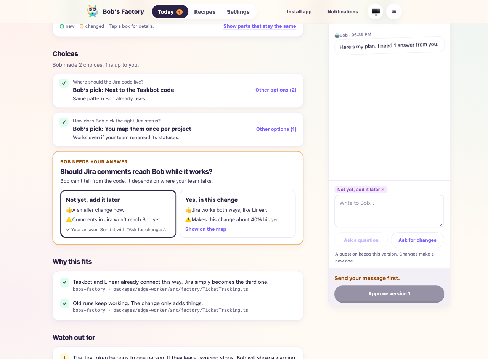
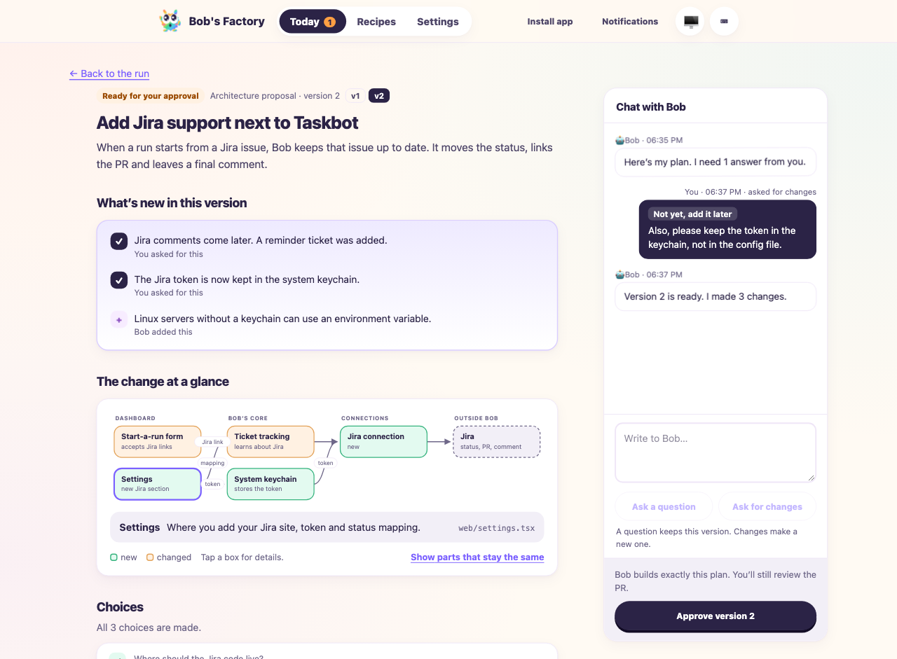
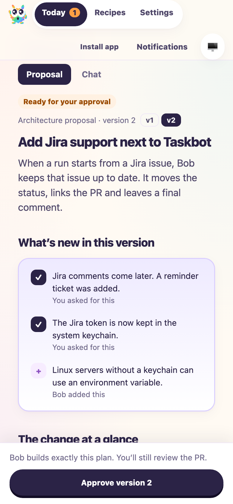

# Architecture proposals as a plain decision brief

Date: 2026-10-11. Taskbot #90, PR #74. This drive follows up on
`2026-10-09-architecture-proposals.md` after the proposal format and screen were
redesigned. Validation made no production changes.

## Applicability and setup

F1 applies because the change alters agent output validation, the human approval
gate and the plan handed to the implementer:

- Proposals now contain choices with options. Choices that only the human can
  answer are marked open.
- An open choice always waits for the human. Approval is refused until a new
  version answers it, even for routine proposals.
- EdgeWorker rejects a revised proposal that does not list what changed. The
  rejection goes back to the agent for correction.
- The accepted plan records who made each choice.

The drive reuses the embedded CLI-platform EdgeWorker setup of the earlier
report: isolated home, fresh local repository, F1 `MockAgentRunner` for every
role, real output validation, pipeline stopped after implementation. The
machine also runs a live legacy coordinator. The drive therefore points
`BOBS_FACTORY_MIGRATION_SOURCE_CAPACITY_DIRECTORY` at an empty temporary
directory instead of draining it.

```sh
BOBS_FACTORY_MIGRATION_SOURCE_CAPACITY_DIRECTORY=$(mktemp -d) F1_AGENT_MODE=mock \
  bun apps/f1/test-drives/media/2026-10-11-architecture-decision-brief/f1-drive.ts
```

## Executed results

All drives passed:

| Workflow | Scenario | Result |
| --- | --- | --- |
| Factory | Meaningful, version 1 has an open choice | Approval of version 1 rejected; three versions; implementation ran once after acceptance |
| Takeover | Meaningful, version 1 has an open choice | Same, with existing PR/branch instructions retained |
| Factory | Routine existing pattern | Completed without a human decision |
| Takeover | Routine existing pattern | Completed without a human decision |
| Factory | Revision without a change list | Output correction requested twice, then the step failed; no version 2 was recorded |

Each meaningful drive also kept explanation, restart and stale-version
behavior from the earlier report. Versions 2 and 3 listed their changes. The
implementer's plan contained `Chosen by the human` for the answered choice.

## Browser validation

`server.mjs` in the media folder starts a real `FactoryServer` with a fixture
runtime and a realistic Jira proposal. In the real dashboard build:

1. The run page and Today queue showed the proposal card with **Open proposal**.
2. The proposal page showed one open question. **Approve version 1** stayed
   disabled with “Answer Bob’s question first.”
3. **Ask a question** kept version 1. Bob’s answer appeared in the chat.
4. Picking “Not yet, add it later” added it to the composer and kept approval
   disabled (“Send your message first.”). **Ask for changes** produced version 2.
5. Version 2 listed three changes, two asked for by the human and one added by
   Bob. Approval became available. Approving showed the read-only approved state.
6. At 390 px, Proposal/Chat tabs and the pinned approve bar rendered correctly.







## Limitations

Agents are simulated, so this does not show how well a real model writes plain
proposals or decides which choices to leave open. Delivery and PR review are
excluded, as in the earlier drive.
