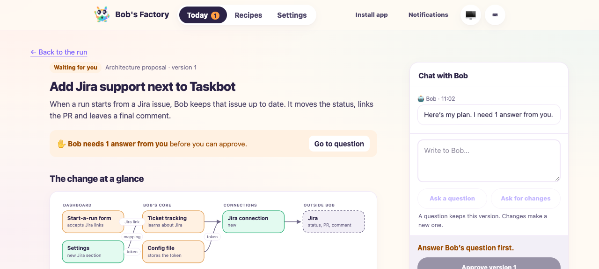
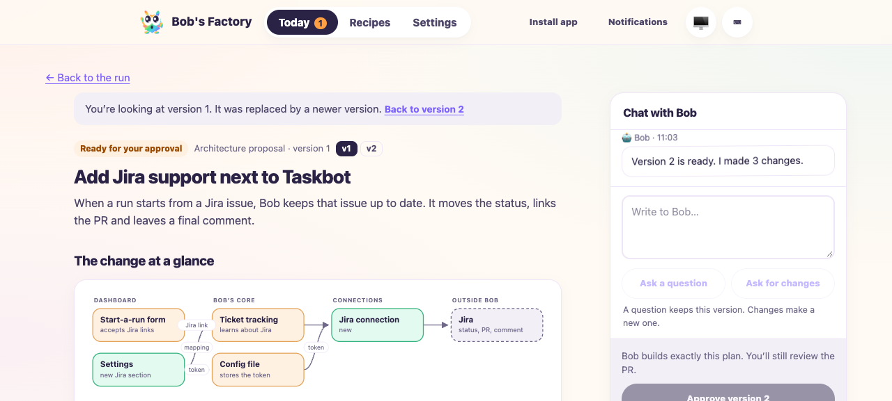
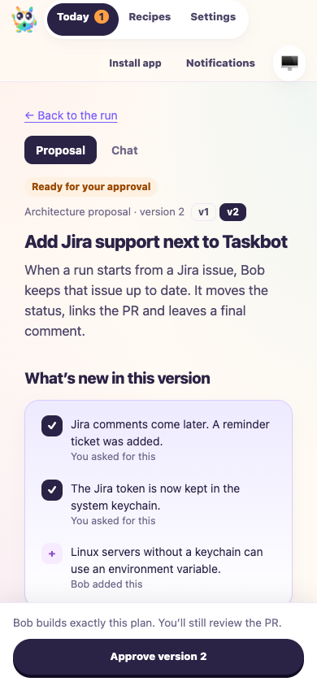
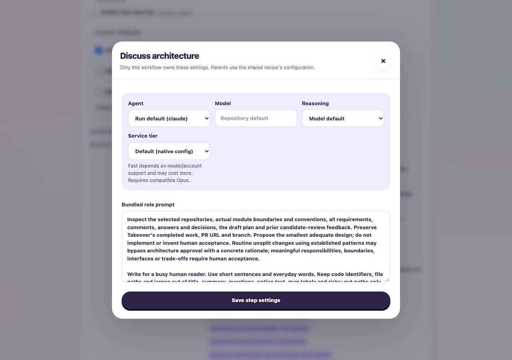

# Bundled workflows and architecture approval integration

Date: 2026-10-12. Draft [PR #83](https://github.com/jappyjan/bobs-factory/pull/83).

Integrated frozen main `84433882ceed569cb93420d3ddc0961e252e0ce8` into tested code revision
`56cda44b617d1784dad054f7c8e23e433d8c65e0`. This report and its assets are a subsequent evidence-only commit.
The [validation receipt](assets/workflow-architecture-integration-r16/validation.json)
records revision ancestry, source fingerprints and hashes of retained raw logs.

## Fixes and compatibility

The eight merge conflicts are resolved. Architecture proposal, review and exact
acceptance now coexist with bundled ownership, separate execution preferences,
private forks, workflow disabling and individual Resume. Native localhost
validation includes the corrected HTTP access expectations from main. The
historical-proposal approval safeguard remains intact. Capability instructions
and the full routing-prompt fixture explain that editing approval policy or
prompts requires a local fork.

Historical fingerprints recognize the newer architecture-enabled releases.
The exact frozen-base source was compared with Git before probing migration.
With Codex model, reasoning and tier preferences, migration retains default
`factory`, creates zero local forks, and leaves mappings/conflicts empty.
See [migration result](assets/workflow-architecture-integration-r16/migration.json).

Saved graphs retain architecture contracts and dispatch support. An unreviewed
candidate is [rejected without starting agents](assets/workflow-architecture-integration-r16/unreviewed-restore.json).
A valid reviewed frozen-base graph [restores the same approval wait](assets/workflow-architecture-integration-r16/reviewed-restore.json),
then starts implementation exactly once after exact acceptance, with zero external
commands. This fixture stops after the implementation checkpoint.

The obsolete upgrader stays removed. Imported architecture migration tests now
exercise WorkflowCatalog: behavioral customization remains private; model-only
preferences adopt installed architecture behavior; existing runs retain their
accepted snapshots. Removing an explicit undefined optional field from the stock
role fixes JSON round-trip comparison, so saving dashboard preferences works.
F1 and browser fixtures customize legitimate private forks.

## Executed checks

- 301 focused tests passed in 11 files: architecture, migration/catalog, runtime,
  pipeline, ticket delivery, access/authentication, server, operator, specialist
  review and full routing prompts. The first run exposed four integration/fixture
  failures; all were corrected before the final run.
- The separately selected architecture-page regression passed (one test). It
  rejects acceptance while a historical version is displayed and stale callbacks.
- Full routing prompts passed again after the capability-text adjustment (five
  tests). Full workspace build/type checks passed, including the final commit hook.
- Repository lint passed with 19 existing warnings; targeted changed-file lint
  passed without warnings. Source/documentation whitespace checks passed. Imported
  historical raw logs retain their original bytes and an existing EOF whitespace
  warning.
- Desktop tests: 34 passed, one skipped because Electron is unavailable. Bash
  syntax checks passed for both smoke scripts; Node syntax checks passed for both
  affected desktop validation scripts. No packaged desktop was launched.

F1 applies to architecture orchestration and saved-workflow migration/recovery.
Both drives ran in disposable homes/repositories with inherited Factory settings
removed. Agents were simulated; no provider credits or production tracker writes
were used.

```sh
python3 <evidence>/qa-f53d9afc/qa-clean-run.py bun run apps/f1/test-drives/media/2026-10-11-architecture-decision-brief/f1-drive.ts
python3 <evidence>/qa-f53d9afc/qa-clean-run.py bun run apps/f1/test-drives/assets/run-workflow-catalog-129.mjs
```

The architecture drive passed five scenarios. Private copies of Factory and
Takeover reject acceptance with open questions, preserve discussion and restart,
regenerate three versions and invoke implementation once after acceptance.
Routine work bypasses additional architecture waits. Missing change descriptions
fail closed. Implementers retain accepted delivery context. Only the terminal
implementation edge is customized to stop the fixture before publication.

The catalog drive passed its seven grouped checks for migration/preferences,
Simple restrictions, private forks, dependency gating, interruption of active and
queued work, restart without automatic continuation, retained native conversations
and attachments, missing-repository recovery, individual operator Resume and
export/import. Expected simulated-runner cancellation appears in its log.

## Inspected headless browser evidence

A fresh named `agent-browser` session used `--headed false`. The built local
fixture displays architecture proposals at desktop and phone widths. Choosing an
answer regenerates version 2. Selecting version 1 disables approval of version 2;
returning to version 2 restores eligibility. Recipes displays editable execution
controls alongside the read-only bundled architecture prompt. All four captures
were inspected; the owned browser and fixture server were closed.









## Remaining limits

Reviewer reassessment, downstream CI/QA, whole-PR brief regeneration and explicit
human approval remain due. The PR stays draft and unmerged. No deployment occurred.
Real agents, live tracker/chat services and packaged desktop behavior were not
retested. Ticket synchronization and private GitGuardian incident closure remain
unconfirmed. Customized legacy Simple stays backed up and recoverably blocked.
Historical chats without a saved model use current defaults; uncertain recovery
without a conversation ID stays blocked.
