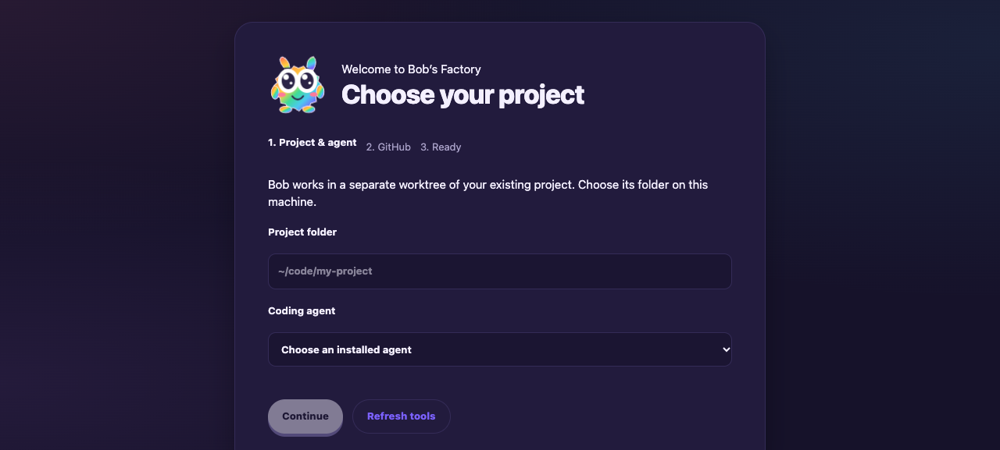
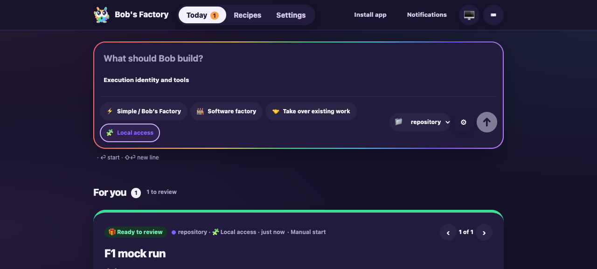
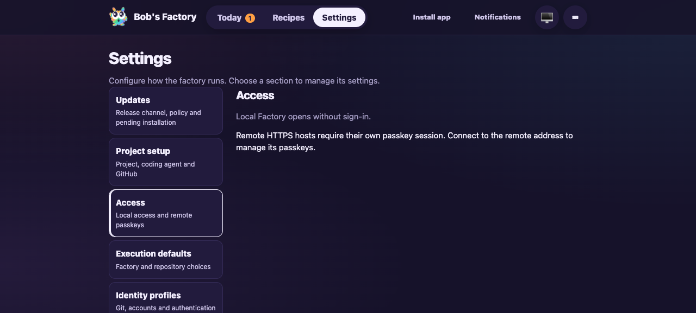
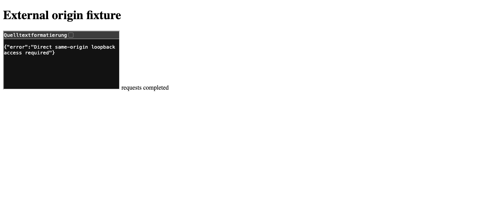

# Workflow and localhost access integration

Date: 2026-10-12. Draft [PR #83](https://github.com/jappyjan/bobs-factory/pull/83).

Integrated frozen main `599a67d12cb204de7e6c5387b83e6d05e28b659e` into
tested code revision `677e5143bfd72e5b6d0cd64c6c4deff70486c925`.
The subsequent evidence commit changes only this report and its assets.
This addresses all four open findings about missing PR #99 access behavior.
Reviewer reassessment, current CI/QA, whole-PR brief regeneration and human review
remain due. The PR remains draft; no approval, merge or deployment is claimed.

The three conflicts were in the Factory guide, capability instructions and full
routing-prompt fixture. Resolution retains direct localhost/IPv6 access and
remote passkey sessions alongside bundled workflow ownership, private forks,
separate preferences/launch settings and individual Resume. The merged server
retains this branch's catalog, availability and recovery endpoints.
Eight workflow/runtime/UI modules are unchanged from the prior head; nine
imported access/launcher modules match the frozen base exactly. The base is now
an ancestor. The [validation receipt](assets/workflow-localhost-integration-r15/validation.json)
records the comparisons and SHA-256 values of the fresh raw validation logs.
Historical reports and raw logs retain their original bytes, including historical
whitespace warnings; whitespace checks on this integration's code/docs delta passed.

## Fresh checks

- EdgeWorker: 19 files, 275 tests passed, including full prompt fixtures, access,
  authentication, onboarding, server, client, media, catalog, runtime and operator checks.
- CLI launch: 7 tests passed.
- Desktop: 34 tests passed; one ASAR check skipped because this checkout lacks
  the materialized Electron binary. This does not establish new native acceptance.
- Full workspace build and type checks passed. Repository Biome check passed with 19 existing warnings.

F1 applies because the integrated changes alter runtime authentication and onboarding.
Both drives used fresh disposable homes and repositories with inherited Factory/Cyrus
settings removed. All agents were simulated. The access drive additionally used
prepared-tool stubs, a real script/worktree, software WebAuthn and local self-signed TLS.

```sh
pnpm build
F1_AGENT_MODE=mock pnpm --filter bobs-factory-edge-worker test:run prompt-assembly test/FactoryAccess.test.ts test/FactoryAuth.test.ts test/FactoryOnboarding.test.ts test/FactoryServer.test.ts test/FactoryServer.update-startup.test.ts test/FactoryWebClient.test.ts test/Video.test.ts test/WorkflowCatalog.test.ts test/WorkflowRuntime.test.ts test/WorkflowOperator.test.ts test/OperatorService.test.ts test/SpecialistReview.test.ts
pnpm --filter bobs-factory test:run src/local.test.ts src/tui/model.test.ts
pnpm --filter bobs-factory-desktop test:run
F1_AGENT_MODE=mock F1_LOCAL_ACCESS_HOLD=1 F1_LOCAL_ACCESS_PORT=3661 F1_LOCAL_ACCESS_TLS_PORT=3662 bun run apps/f1/test-drives/assets/localhost-noauth.ts
F1_AGENT_MODE=mock bun run apps/f1/test-drives/assets/run-workflow-catalog-129.mjs
pnpm typecheck
pnpm lint
```

The CLI command selected the seven local-launch tests; the optional model path
matched no file. The drives and CLI command ran through the retained environment
isolation wrapper at `qa-f53d9afc/qa-clean-run.py` in the supplied evidence directory.

The localhost drive passed eight assertions: unauthenticated localhost/IPv4/IPv6
API access; first-launch setup; actual IPv6 project save; script run/worktree
completion; rejection of forwarded/cross-origin requests; remote passkey
enrollment/login/logout through a Host-preserving TLS proxy; token-free local
events surviving remote enrollment; and actual foreign-origin browser navigation,
read and POST rejection with no run mutation. Its three foreign-origin requests
all returned HTTP 403.

The catalog drive passed seven grouped assertions covering exact-byte migration,
six reviewer preference overlays, Simple restrictions, private forks, dependency
gating, active/queued interruption, restart without automatic continuation,
retained native conversation/attachments, missing-repository recovery, individual
operator Resume and export/import. Expected simulated-runner cancellation appeared
in the interruption log; the drive completed successfully and shut down its worker.

## Inspected headless browser evidence

A fresh named `agent-browser` session used `--headed false`. Onboarding and the
dashboard opened without a cookie or passkey. Access explains local authority and
remote sessions. A foreign-origin page could neither embed private content nor
read/mutate it. All four screenshots were inspected; the owned browser and fixture
listeners were closed afterward.









Raw logs, original F1 receipts and browser text are retained under
`/Users/jappy/.cyrus/factory/evidence/manual-3db22f15-582b-4d93-82fb-9ab119d3f716/fix-r15-*`.
No real agents, physical authenticator, packaged desktop or live tracker/chat
services were tested. Ticket synchronization and private GitGuardian incident
closure remain unconfirmed. Customized legacy Simple stays backed up and blocked
pending explicit recovery. Historical chats without a saved model retain the
current-default fallback; uncertain recovery without a conversation ID stays blocked.
