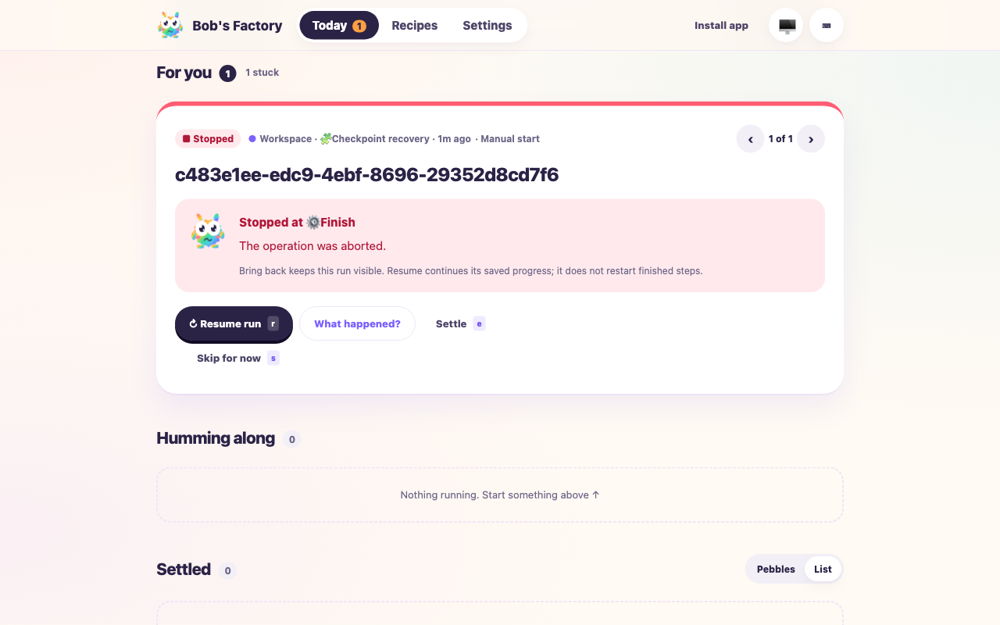

# Bring back and explicit stopped-run resumption

Date: 2026-10-13. Tested from main `41494914d14dbb02b8ee902459588acb40214c1f`
with the bring-back fix in the working tree. Native providers were not invoked.

## Reproduction

The three reported runs remained saved with `status: stopped` and
`viewState.keptOpen: true`. Bring back removed their Settled classification, but
neither attention nor active-work classification included them. A capture replay
using the shared Today classifier failed with `bucket: MISSING` before the fix
and returned `for-you` for all three afterward. The two stopped/cancelled
regressions failed before the classifier change. A stopped-run checkpoint
regression failed before the runtime offered explicit resume.

## Mocked lifecycle and browser drive

```sh
pnpm --filter bobs-factory-edge-worker build
F1_AGENT_MODE=mock bun apps/f1/test-drives/assets/bring-back-stopped-runs.mjs
# Also runnable unattended, without the browser:
F1_AGENT_MODE=mock bun apps/f1/test-drives/assets/bring-back-stopped-runs.mjs --api-only
```

The isolated fixture completed preparation, checkpointed a controlled mock native
session during its second step, then stopped. After shutdown and reconstruction,
`resumeAll` left it stopped, including when its saved view was kept open.
The authenticated Bring back API retained `stopped`, produced operator attention,
and executed no additional agent calls. Dashboard projection exposed resume
availability without including the native checkpoint.

In the actual built dashboard at localhost:3600, Bring back moved the fixture from
Settled to a visible **Stopped** card under **For you**, with **Resume run** enabled.
Clicking Resume run sent the protected resume endpoint a request, received HTTP
202, and completed the remaining step. The fixture retained its mock native session
and original completed history. Calls were exactly `prepare, finish, finish`;
preparation did not replay. The resulting dashboard showed the completed run for
review. The fixture server was then gracefully stopped.



## Targeted checks

- Edge-worker API/access, web client and runtime: 175 tests passed, including the new
  resume endpoint access test and strengthened duplicate-resume guard.
- MCP operator integration: 11 passed, including stopped and interrupted resume.
- Terminal dashboard: 12 passed, including reopened stopped-run grouping.
- Edge-worker build, edge-worker/CLI/MCP type checks and changed-file Biome passed.

## Scope and limits

This drive exercised real workflow persistence, stop/restart, view and resume API
handlers, and the built web controls. Agent execution was controlled mock behavior;
it does not claim authenticated provider execution or a production release upgrade.
Bring back remains a visibility action. Only explicit Resume executes stopped
work, without resetting retry budgets, frozen workflow definitions or review gates.
The production workaround used the existing view API to return the three hidden
cards to Settled; their workflow execution state and saved work were unchanged.
