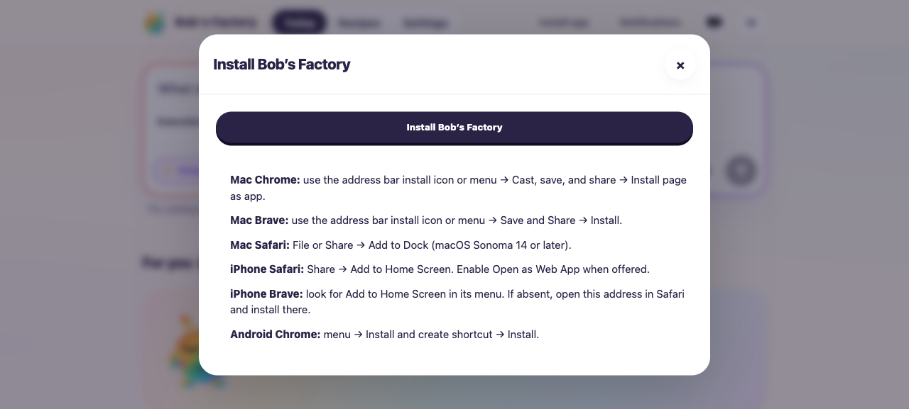
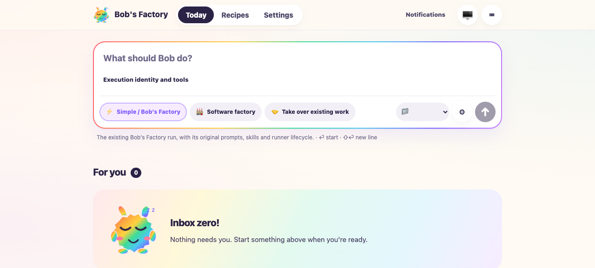
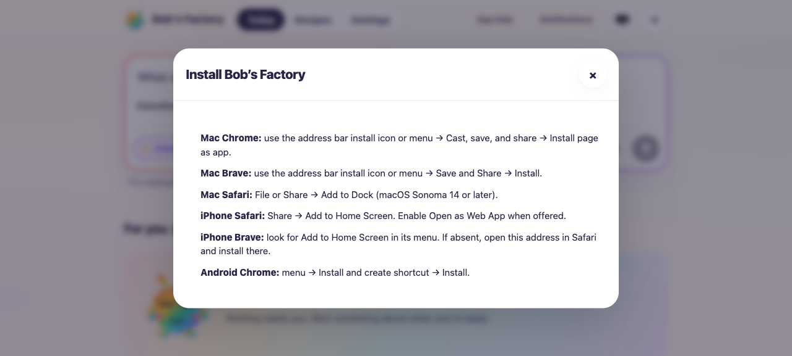
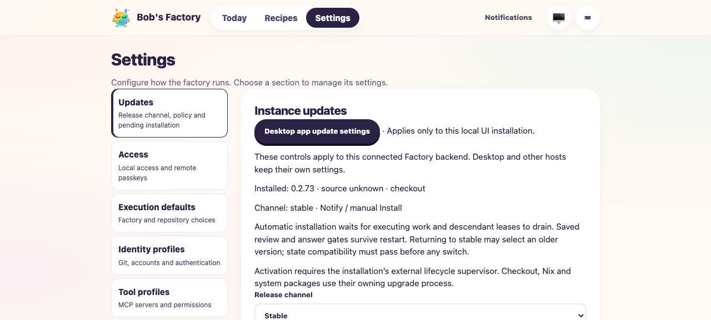

# Hide browser installation controls in the desktop app

Date: 2026-10-13. Tested base `043eea7e540090e97261ae688ca470c6aefeddac`
plus the implementation delta in `pwa-ui.tsx`, `Workflow.ts` and `CHANGELOG.md`.
Shell build: `1c94b12777954ff902b21dc1`.

Source `pwa-ui.tsx` SHA-256:
`282c5629f7a625b5a33ad2cd8113f4a02d631558c4657921a70e8a6d6cd97bae`.
Served JavaScript SHA-256:
`74f78953d6216665b71227ebc07ade0747facd193eb577c11f7d6db6f6b51b8b`.

## Scope and fixture

F1 applies to the shared dashboard installation UI. Two real source-built
FactoryServer instances served the rebuilt dashboard at `http://localhost:3761`
and `http://localhost:3762`, with separate temporary homes. WorkflowRuntime
handlers were simulated, `F1_AGENT_MODE=mock`; no agent or issue lifecycle was
invoked. No production state or backend configuration was changed.

Fresh headless agent-browser sessions tested normal browser mode, simulated
installed-PWA mode and simulated desktop mode. Desktop mode used an init script
before initial navigation:

```js
window.factoryDesktop = {
  openAppUpdates: async () => {
    window.desktopUpdatesOpened = (window.desktopUpdatesOpened || 0) + 1;
  }
};
```

The PWA fixture overrode only the `matches` property of the MediaQueryList for
`(display-mode: standalone)` before loading the dashboard. It did not define
the desktop bridge.

## Results

- Normal browser: the accessible `Install app and help` button showed `Install
  app`, opened `Install Bob’s Factory`, displayed the unchanged installation
  guidance and browser install button, and closed with Escape. Dialog count
  after closing: zero. The second endpoint also showed `Install app` without
  the bridge.
- Installed browser PWA fixture: standalone display was true, desktop bridge
  absent, and the button showed `App help`. The same help dialog opened and
  closed normally; no native browser install button appeared in this mode.
- Simulated desktop: bridge present on initial load, installation control count
  zero, dialog count zero. Neither installation label appeared. These counts
  stayed zero after navigating to Settings and Updates on each endpoint.
- Notifications remained available and opened its existing device dialog.
  Theme controls remained available; selecting Dark set the document theme to
  `dark`. Clicking `Desktop app update settings` invoked the simulated bridge
  exactly once. The second endpoint also rendered the desktop update action.
- Browser and simulated desktop screenshots below were inspected. All named
  browser sessions were closed and both fixture servers stopped successfully.

## Commands and verification

Evidence scripts are retained in
`/Users/jappy/.bobs-factory/factory/evidence/manual-ff5756c6-8a2e-47c2-856b-2751d187a2d2/`:
`install-fixture.mjs`, `desktop-init.js`, `pwa-init.js`.

```sh
pnpm --filter 'bobs-factory-edge-worker...' build
pnpm --filter bobs-factory-edge-worker typecheck
node packages/edge-worker/scripts/build-factory-web.mjs
pnpm exec biome check packages/edge-worker/src/factory/web/pwa-ui.tsx packages/edge-worker/src/factory/Workflow.ts
pnpm --filter bobs-factory-edge-worker test:run test/FactoryPwa.test.ts test/FactoryServer.test.ts test/FactoryWebClient.test.ts
F1_AGENT_MODE=mock node "$EVIDENCE/install-fixture.mjs"
agent-browser --headed false --session d187-web open http://localhost:3761
agent-browser --headed false --session d187-desktop --init-script "$EVIDENCE/desktop-init.js" open http://localhost:3761
agent-browser --headed false --session d187-desktop-second --init-script "$EVIDENCE/desktop-init.js" open http://localhost:3762
agent-browser --headed false --session d187-pwa-final --init-script "$EVIDENCE/pwa-init.js" open http://localhost:3761
# snapshot -i, click, eval, screenshot and press Escape used for the assertions above.
git diff --check
```

Build, typecheck, bundle generation, Biome and whitespace checks passed.
All **69 tests across three suites passed**. Initial typecheck/bundle attempts
failed because this fresh worktree had no compiled workspace dependencies;
the dependency build resolved them. The first PWA init script attempted to
assign a read-only `matches` property; correcting it with `Object.defineProperty`
and starting a fresh context produced the passing PWA result. A CLI selector
wait stalled during the first desktop session's endpoint switch; that command
was stopped and the second endpoint was verified in a fresh headless session.

## Limits

The two isolated HTTP endpoints represent selecting another Factory instance;
this drive does not claim a real remote HTTPS connection, Electron execution,
provider credits, OS installation or native update IPC. It verifies the accepted
client-bridge visibility rule against the same actual dashboard on both servers.
The existing PWA/connection/client suites provide regression coverage for the
unchanged connection and update subsystem. Push delivery was not enabled.

## Screenshots








