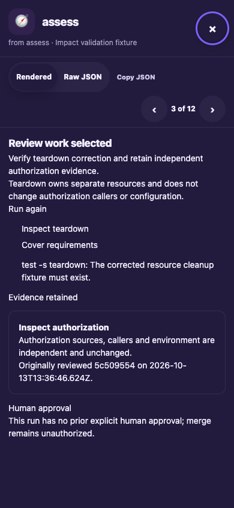

# Impact review convergence test drive

Date: 2026-10-13. Task: [Taskbot #132](https://taskbot.apps.janjaap.de/p/bobs-factory/t/132).
Agent mode: **simulated agents only** (`F1_AGENT_MODE=mock`); no provider credits used.

## Tested implementation

Checkout baseline: `a544fd2b1a93693ac15e438aea9c772f72f28811` plus uncommitted implementation.
Changed edge-worker source fingerprint: `f211989e43be9b5520074f9937d796437eff2403f18736dbda09bf653eeff1b1`.
The fingerprint includes sorted changed and new source/test files, each encoded as
path, NUL, file contents, NUL. The manifest is retained with the runtime evidence.
The compiled package was built from these sources before the native drive.

This change adds independent impact assessment, selective specialist/check/QA
execution, immutable original evidence reuse, cumulative approval continuation,
non-mutating target integration analysis, calibrated findings and bounded correction
cycles. Frozen saved workflows retain conservative behavior.

## Commands and results

- `pnpm --filter 'bobs-factory-edge-worker^...' build`: dependency builds passed.
- `pnpm --filter bobs-factory-edge-worker build`: package and web build passed.
- `pnpm --filter bobs-factory-edge-worker typecheck`: passed.
- Targeted Biome check of the 27 changed TypeScript files: passed.
- `git diff --check`: passed.
- `env -u BOBS_FACTORY_INTERNAL_EXECUTABLE F1_AGENT_MODE=mock pnpm --filter bobs-factory-edge-worker test:run test/Impact.test.ts test/SpecialistReview.test.ts test/WorkflowRuntime.test.ts test/FactoryPipeline.test.ts test/Incremental.test.ts test/FeedbackPolicy.test.ts test/CISupervision.test.ts test/DeliveryCoordination.test.ts test/FactoryRepositoryScope.test.ts test/GitProvider.test.ts test/Guide.test.ts test/ReviewBrief.test.ts test/FactoryProvenance.test.ts test/prompt-assembly.routing-context.test.ts test/MachineCapacity.test.ts test/IntegrationCapacity.test.ts`: **375 tests passed in 16 suites**, 60.84 seconds. An earlier run exposed a missing test import; the import was fixed before this complete rerun.

The tests use real disposable Git repositories with JavaScript and Python layouts,
non-default target branches and controlled agent replies. They execute workflow
selection and MCP context retrieval rather than calculating hypothetical counts.
They cover renamed roles, nested workflows/restart, per-repository checks and
provider bindings, target advance/overlap/conflicts, strengthened provenance,
unchanged requirements and custom source fingerprints, stale approval rejection,
safe production correction continuation, optional/duplicate findings, downstream
obligations, failed review assistance, unchanged/alternating correction bounds, and
QA definition/fixture/environment invalidation. Earlier replay failures were fixed
and are covered by the final passing suites.

## Native EdgeWorker drive

Executed the actual compiled EdgeWorker with a fresh Factory home, temporary Git
repository, local bare origin, protected manual-run API and injected MockAgentRunner
for every provider and background title. The fixture target branch is `release`.
The driver is retained as `native-impact-drive.mjs` in the evidence directory.

```sh
env -u BOBS_FACTORY_INTERNAL_EXECUTABLE F1_AGENT_MODE=mock \
  BOBS_FACTORY_FACTORY_PORT=4813 bun <evidence>/native-impact-drive.mjs
```

Run: `manual-2223dab2-9fb2-468d-ae27-776e19317150`.
The initial assessment extracts scope, runs the selected shell check and all three
configured specialists. A committed teardown correction triggers another
independent assessment, reruns quality and coverage, and retains the original
authorization receipt. Actual role calls: assess, inventory, security, quality,
coverage, assess, quality, coverage. The aggregate approves; no human approval
exists and merge stays unauthorized. Original security execution details remain
visible. No PR was created or provider merge attempted.

The CLI tracker fixture creates issue `issue-1` and session `session-1`.
`viewSession` returns four timestamped activities, including routing to `release`
and a final response. The Factory session reaches complete. The CLI fixture's
tracker receipt still reports active; this smoke check does not claim terminal
tracker synchronization. Server shutdown and exact temporary fixture removal were
confirmed. An initial missing request header and inherited internal-executable
setting were corrected; a redundant later server launch hit the still-running
fixture port, leaving the successful drive intact.

## Measured work and context traffic

| Measurement | Full route | Selected route |
| --- | ---: | ---: |
| Specialist calls (both layouts) | 12 | 8 |
| Requirement extraction calls | 2 | 1 |
| Workflow visits | 21 | 20 |
| Actual MCP context calls | 44 | 48 |
| Retrieved characters, JavaScript | 770,086 | 1,041,252 |
| Retrieved characters, Python | 770,086 | 1,043,508 |

Two assessment calls are added. Net agent invocations fall by three.
Context characters **increase by about 35%** because controlled agents read their
complete supplied context, including the new impact evidence. These are observed
MCP tool calls and response characters, not token billing or production performance
estimates. No token, cost or elapsed-time saving is claimed.

## Headless inspector verification

Used agent-browser 0.27.0 with fresh named sessions and explicit `--headed false`.
The inspector shows selected role names, check reasons, the original retained
review's revision/date, and the absence of human approval. At 390 × 844, the page
has no horizontal overflow; the screenshot below was inspected. At 1280 × 577,
a DOM check also found no horizontal overflow. Desktop screenshot capture stalled
and was terminated; no desktop image is accepted as evidence. The earlier file
named `impact-desktop.png` was actually mobile-sized and is excluded.



## Limits

Simulated agents confirm runtime safeguards and orchestration, not the quality of
real model judgments. Real remote GitHub/GitLab checks, paid agent calls, production
rollout and real provider merge were not executed. Grouped/provider behavior uses
controlled adapters and real local Git state. Behavioral QA reuse is exercised by
automated fixtures; this inspector screenshot does not prove product behavior.
Desktop screenshot tooling remains a validation limitation. Tracking mutations,
publication and final delivery approval belong to later workflow roles.

Runtime logs, source manifest, native result, activity payloads, cleanup receipt
and test output are retained under
`/Users/jappy/.bobs-factory/factory/evidence/manual-2bd6b169-9864-4eba-be58-afcc28fbd1c6/impact-implementation`.
