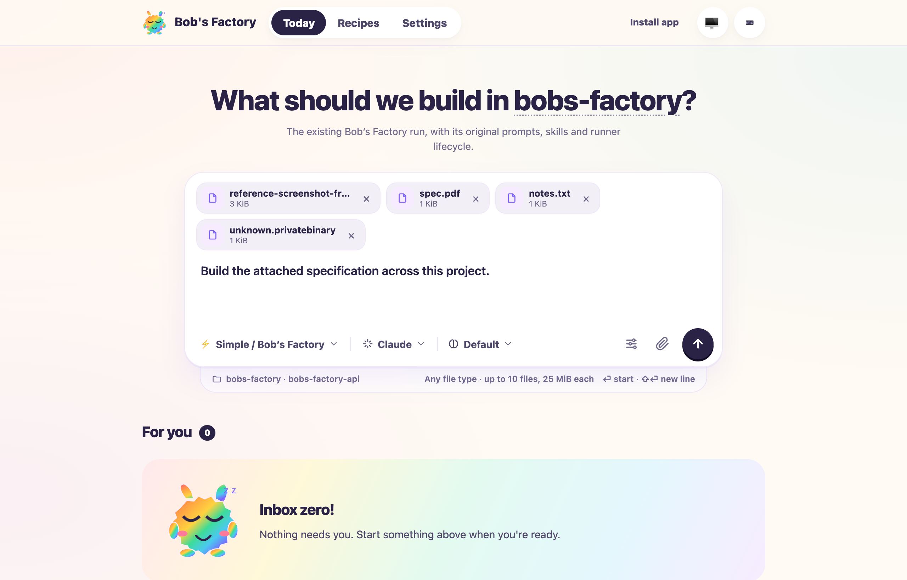
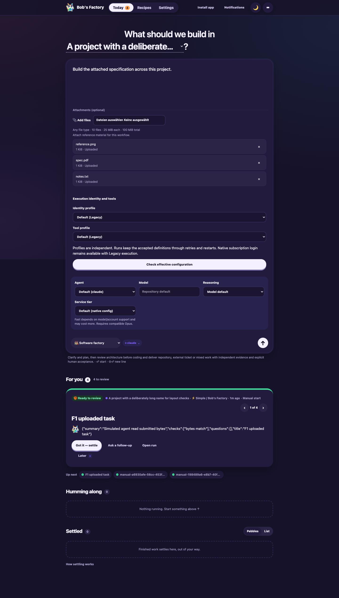
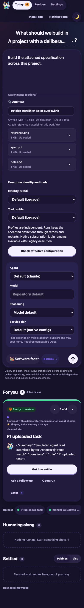
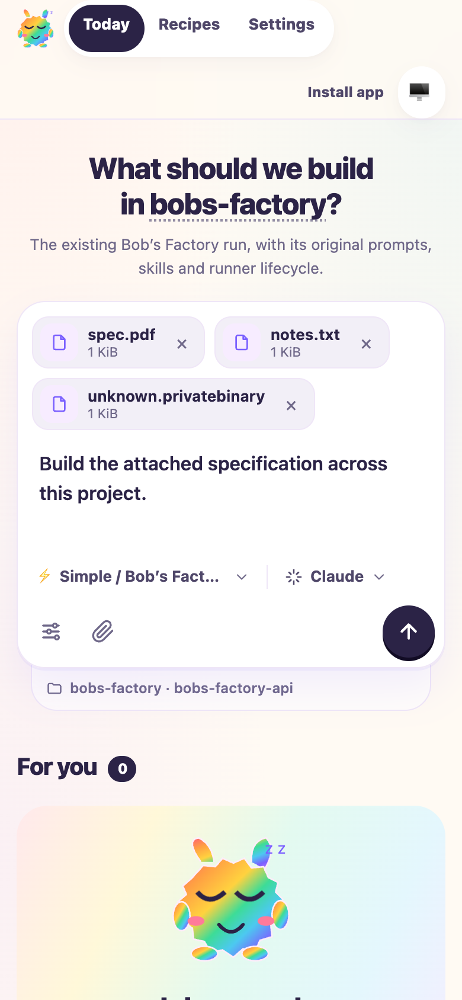
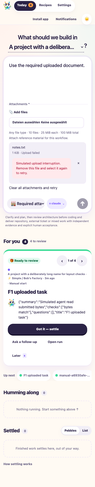
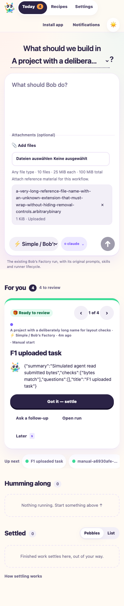

# Manual launcher and private workflow uploads

Date: 2026-10-13. Taskbot [#85](https://taskbot.apps.janjaap.de/p/bobs-factory/t/85).

The launcher now places project selection in its heading, keeps workflow inputs
visible beneath a roomy prompt, and accepts files only for declared attachment
fields. Machine selection remains separate work in BOBS-84.

## Applicability and evidence

F1 applies to manual admission, attachment persistence, workflow context and
runner read access. This drive uses isolated temporary homes, two fresh local
Git repositories grouped by routing labels, the real EdgeWorker/FactoryServer
HTTP path, and deterministic F1 `MockAgentRunner` instances for every role and
title job. It does not invoke an agent CLI or inference API.

Expected outcomes were exact uploaded bytes in role context, complete grouped
scope, rejection of undeclared/required/oversized inputs, single ownership under
concurrent admission, retained restart/retry state and usable Simple instructions.
All executed assertions passed:

| Path | Verified behavior |
| --- | --- |
| Guarded HTTP upload | PNG, PDF, text and unknown binary bytes are stored privately; empty MIME values work. |
| Removal and failed admission | Removed IDs cannot launch; rejected requests leave usable staged files. |
| Conditional inputs | A workflow without file fields rejects uploads/attachments; required files cannot be omitted. |
| Limits | HTTP rejects a file over 25 MiB with an actionable error. Unit checks additionally enforce 10 files and 100 MiB total. |
| Claim ownership | Concurrent submissions produce one run. Submitted drafts cannot be reused or recreated by late uploads. |
| Grouped scope | Both app and API repositories reach the launched run and its worktrees. |
| Simulated role | The role receives its manifest/explicit attachment input, reads exact bytes and has the claimed directory in runner read allowances. |
| Restart and retry | A fresh runtime reloads unchanged paths/content; a failed role resumes with retained files after retry. |
| Simple | Its assembled instructions contain canonical paths; the simulated runner reads the submitted text and receives read access. |
| Architecture and nested roles | A behavioral unit check passes files through nested explicit inputs and verifies that candidate asset snapshots contain the exact bytes. |

Run from the repository root:

```sh
F1_AGENT_MODE=mock bun apps/f1/test-drives/media/2026-10-13-launcher-uploads/f1-drive.ts
```

The final non-serving drive returned `result: passed`, stopped its worker and
exited with code 0. Add `--serve` for a headless browser fixture. Uploads use a
native HTTP test client that consumes error responses and closes rejected
connections. The product also closes oversized upload connections after its
413 response.

## Browser verification

A fresh named `agent-browser` session ran explicitly headless. Actual UI actions
verified four file types, removal, workflow switching, required Takeover source,
agent settings and identity/tool selectors. Settings and files reset with their
form context. A deliberately intercepted upload failure displayed an actionable
error and disabled launch; removal/reselection recovered successfully.

Shift+Enter inserted a newline. An IME Enter event created no run. Two submit
attempts in one event turn created one run, retained both repositories and the
selected file, then cleared the submitted draft. Native Enter also launched.
Long project/file names and 390 px screens showed no horizontal overflow.

All six captures were opened and inspected. They use product source revision
`8baccedc31f5816a51eae6399225678b81223dc0` with uncommitted changes and web build
`350bac66c2a9b00a30be0156`. The source digest and screenshot hashes are in
[the evidence receipt](media/2026-10-13-launcher-uploads/evidence.json). These are
implementation evidence; later revision-bound QA and human acceptance remain
pipeline responsibilities. A final backend-only input-name compatibility fix
was verified after the captures; the web bundle did not change. The receipt
separately records the latest validated backend source digest.













## Targeted checks and limitations

Targeted Vitest checks passed **211 distinct tests across 10 files**: launch asset
storage/schema, FactoryServer, FactoryAccess, WorkflowRuntime, repository scope,
web client, execution settings, onboarding and full prompt assembly expectations.
The command environment unsets `GITLAB_BOT_USERNAME`; the host value otherwise
adds unrelated attribution to complete prompt expectations. Earlier combined
runs exposed an HTTP fixture cleanup timeout. One-shot connections now close,
configuration bodies drain, and event streams abort explicitly; the affected
access/server/runtime batch passed all 152 checks, and the remaining batch
passed 58. A final compatibility check added one regression and passed 130
asset/runtime tests: file-field aliases preserve existing step results and ignore
inherited object names.

`pnpm --filter bobs-factory-edge-worker typecheck`, the edge-worker build including
its web bundle, and changed-file Biome checks passed. Biome reports 17 existing
CSS warnings outside the new launcher styles. No dependencies changed.

Agents are simulated. Native model quality and native tool file-format support
are unverified; arbitrary bytes do not imply automatic document parsing. The
embedded CLI fixture logs a handled missing-comment warning during Simple setup;
its attachment assertions and completed execution pass. This drive excludes
publication, merge and real originating-ticket synchronization. Taskbot's
retained `The operation was aborted` synchronization error remains unresolved.

## Merge correction validation

The CI fixer merged base `ef01f788b9132f2eddbbc7c2171634ff9dbc59e8` into
PR #123 from `58b15a882ac59f3ecf7fa13bde0ec284ca761905`. Capability instructions
retain both launcher attachments and the base's frozen workflow, desktop and
notification guidance. Both independently appended FactoryServer tests remain.
The complete routing-prompt expectation includes the combined reference.

The same `F1_AGENT_MODE=mock bun` drive above passed on the combined source,
including exact bytes, grouped scope, claim races, restart/retry and Simple
read access. Its synthetic Simple tracker logged a missing `issue-1` context
warning; the asserted attachment and execution outcomes still passed.
Typecheck, edge-worker/web build and 201 targeted tests passed. Biome and
`git diff --check` passed. Existing screenshots were preserved; this correction
did not repeat browser captures or test real agents. Human acceptance and
fresh pipeline review remain required.
