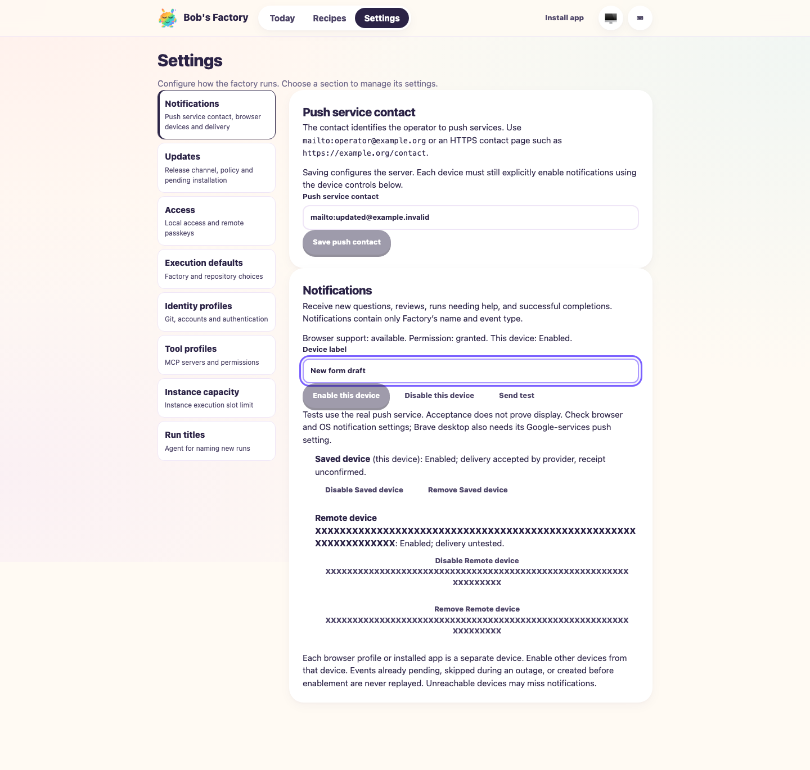
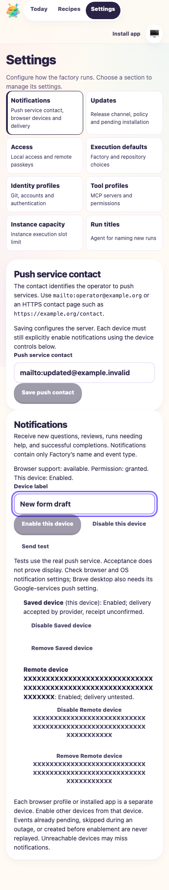

# Notifications Settings after merging push contact configuration

Validated on 2026-10-13 while resolving PR #115 against `main` at
`3b2b0bf85ee8688a84ddc601e6584f7c0ea5a782`. The tested worktree was based on
`f954efe47d94c9df21269150ac71765f470c7e06`, with the merge and integration edits.
Tracked diff SHA-256: `3892fb414af3e93b74d1d8b8f9eb5cb975625945914c4bc30b4bf9a5df3e1f35`.
Served web build: `31e2ef87398283eed799e290`.

The latest base added a push contact editor at the same Settings route. The merge
retains it alongside the inline browser-device controls and dashboard-wide
reconciliation. Successful contact saves refresh device availability immediately.
Capability instructions and their complete prompt expectations retain both changes.

## Validation

The embedded F1 fixture uses an isolated home/repository, simulated agents
(`F1_AGENT_MODE=mock`, `f1AgentHandlers("mock")`), controlled browser push APIs
and a recording sender. It starts without a push contact, so the browser sets it
through the actual protected API. No production devices or inference APIs ran.

Commands:

```sh
pnpm --filter bobs-factory-edge-worker typecheck
pnpm --filter bobs-factory-edge-worker test:run test/FactoryNotifications.test.ts test/FactoryPwa.test.ts test/FactoryWebClient.test.ts test/FactoryPush.test.ts test/FactoryServer.test.ts test/prompt-assembly.routing-context.test.ts
pnpm --filter bobs-factory-edge-worker build
F1_AGENT_MODE=mock F1_EVIDENCE_DIR=<evidence> node --experimental-strip-types apps/f1/test-drives/assets/notifications-settings.ts
F1_EVIDENCE_DIR=<evidence> node <evidence>/functional-driver.mjs
```

All 104 focused tests, type checking, build, changed-source Biome and whitespace
checks passed. Biome reports three existing informational template suggestions
in the browser driver. Signed-out remote config and push requests returned 401.

All 26 headless browser assertions passed, including:

- Direct navigation, reload, inline controls and absence of the header modal.
- Initial contact save refreshes Enable availability without navigation or consent.
- Leaving Notifications discards unsaved contact edits.
- Contact updates preserve the server key, registered device and browser consent.
- Explicit permission requests, denied/unsupported states, enable and test send.
- Device-label draft resets and delayed action protection across navigation.
- Remote disable/removal, permission/key changes and deferred cleanup on Today.
- Access-loss form clearing and preservation of opt-out bookkeeping.
- The 390px layout has no horizontal overflow with a long device label.

## Evidence and limitations

Evidence directory:
`/Users/jappy/.bobs-factory/factory/evidence/manual-9d3697a3-1223-4b28-ad0d-d91f0e797e70/merge-validation`.

`revision.json`, `functional.log`, `notifications-browser-results.json`,
`notifications-protected-access.json`, `notification-sends.json` and
`functional-driver.mjs` retain the executed evidence. The functional driver is
an exact copy of the tracked driver with a fresh session name and only its two
screenshot calls removed. The isolated fixture and browser were stopped.

Initial browser checks exposed the CLI clicking an offscreen button without
scrolling; the tracked driver now explicitly scrolls buttons into view and waits
for Enable availability. Screenshot calls subsequently stalled Chrome capture.
CLI diagnostics passed, but fresh headless sessions, disabled GPU rendering and
bounded direct Chrome capture attempts also failed. The final functional drive
therefore excludes screenshot calls. No fresh images were captured or visually
inspected for this combined page. Historical screenshots and reports are preserved;
this report does not upgrade them to evidence of the merged page. Narrow layout
has DOM-based evidence only. OS display and physical-device background delivery
remain unverified. App-update route restoration is covered by the PWA unit suite.

## Visual validation follow-up (2026-10-13)

Fresh screenshots now complete the combined-page visual check. The earlier
capture failures above remain historical evidence of the first attempt.
This follow-up tested clean source revision
`63420832fa02ead3b10fe6d8c8ae7c66283030bf` with a fresh build of the same web assets
(`31e2ef87398283eed799e290`). Subsequent changes contain only this evidence and
the changelog note; application code and served assets are unchanged.

The isolated fixture again used simulated agents, controlled browser push APIs
and a recording sender. Its protected-access assertions passed. The setup replay
passed all 12 checks through delayed-action protection, then registered a remote
device with a 65-character unbroken suffix to exercise label wrapping.

Chrome 148 again timed out capturing a screenshot. Switching the fresh named
agent-browser session to the installed Chromium 149 **headless shell** succeeded.
No desktop browser or existing browser session was used. Launch command:

```sh
agent-browser --session notifications-shell-0e797e70 \
  --executable-path /Users/jappy/Library/Caches/ms-playwright/chromium_headless_shell-1228/chrome-headless-shell-mac-arm64/chrome-headless-shell \
  --headed false open http://localhost:3647/#/settings/notifications
```

Captured full-page images with `set viewport 1440 1000` and
`set viewport 390 844`, followed by `screenshot <path> --full`. Both images were
opened and visually inspected. The header and active Settings navigation remain
usable. Both the push contact editor and Notifications device controls are
visible and readable. The long device label and its action buttons wrap within
the card; the phone layout stacks the cards and controls without clipping.
DOM checks also confirmed no horizontal overflow, all form controls within the
viewport width, both section headings and no Notifications dialog or header
button. The browser error log was empty.





The [revision receipt](assets/notifications-merged-visual-revision.json) records
the tested source, web build, browser version, image dimensions and SHA-256 hashes.
The additional evidence directory is
`/Users/jappy/.bobs-factory/factory/evidence/manual-9d3697a3-1223-4b28-ad0d-d91f0e797e70/visual-validation`.
It retains `visual-shell-setup.mjs`, `shell-setup.log`, `fixture.log`,
`layout-check.mjs`, `layout-results.json`, `final.snapshot.txt`,
`browser-errors.txt`, the images and `revision.json`. The setup script copies
the tracked browser driver through remote-device registration, changes only the
session/executable and adds bounded command timeouts. The created browser session
and isolated fixture were stopped after capture.

This resolves the missing desktop/phone visual evidence. It does not establish
OS notification display or physical-device background delivery; those limits
remain unchanged.
