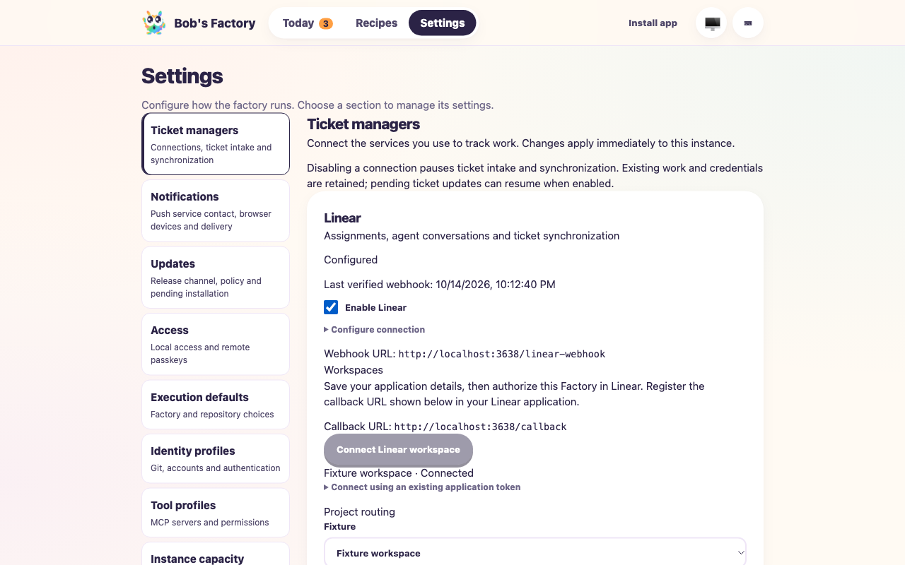
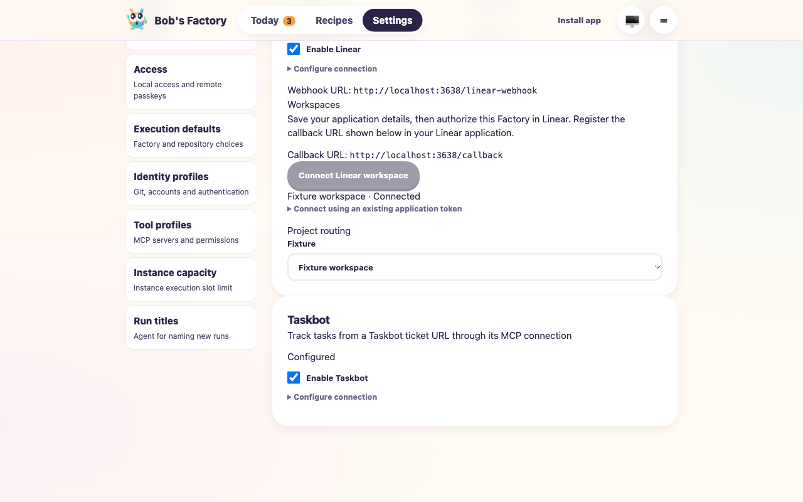

# Unified startup and ticket-manager settings

**Date:** 2026-10-14
**Validated source:** `e2ce792cfa54ce56ffd1949ab29fb04afe74947f` (the same implementation tree validated before committing; subsequent changes are this report and changelog)
**PR:** [#133](https://github.com/jappyjan/bobs-factory/pull/133)
**Behavior:** one production startup, live ticket-manager policy/configuration, retained native credentials and explicit F1 fixture injection.
**Agents:** deterministic mocked runners; script workflow. No native agents, inference, real provider network calls or production configuration changes.

## Scenario and assertions

The drive creates a fresh Git repository and bare local remote. A legacy configuration deliberately contains `platform: "cli"` alongside a configured workspace. The harness injects an in-memory tracker explicitly; it exercises the actual signed Linear HTTP listener, authenticated dashboard API, routing, worktree creation, workflow runtime, persistence and activity output.

Command:

```sh
F1_AGENT_MODE=mock bun run apps/f1/test-drives/assets/ticket-managers.ts
```

All assertions passed:

1. A signed assignment reaches the mounted listener, routes to the configured project, creates a worktree and completes the controlled script workflow.
2. The originating ticket session has visible activities.
3. Saving disabled Linear settings returns 503 for subsequent signed deliveries and creates no run for the rejected event.
4. A standalone manual workflow completes with the manager disabled.
5. Restart retains the disabled state and still rejects intake.
6. Re-enabling accepts and completes a new signed assignment without replacing the listener.
7. Saving settings removes the legacy platform selector while retaining workspace credentials and history.
8. Settings responses redact signing credentials; forwarded callers cannot use direct localhost authority.

Final drive output: `passed: true`, `mocked: true`, `providerNetworkCalls: 0`.
The disposable home was `/var/folders/5m/3pxzz_nd1v7f34rd9vnm01380000gn/T/f1-ticket-managers-ut2i2Z/home`.
The fixture used dashboard port 3637 and webhook port 3638, then shut down cleanly.

## Browser and startup checks

The collaborative browser showed the actual compiled Settings → Ticket managers page. Clicking Enable Linear changed the saved status to Disabled immediately; clicking again restored Configured. Configuring a disposable Taskbot MCP URL through the form produced Configured with no alert. This verifies configuration, not real Taskbot connectivity.





A separate actual CLI smoke used a fresh `/tmp/bobs-unified-cli.YHB4wx` home:

```sh
bun run apps/cli/src/app.ts --home /tmp/bobs-unified-cli.YHB4wx --port 3645 --no-open
bun run apps/cli/src/app.ts service install --help
```

- `/api/config`: 200 and guided setup available.
- `/api/ticket-managers`: 200, Linear disabled until configured.
- `POST http://localhost:3646/linear-webhook`: 503 with a configuration/policy diagnostic, rather than 404.
- Saved configuration contains no `platform` selector.
- Service install help exposes no `--mode` option.
- The disposable CLI process was terminated gracefully.

## Additional validation

- Full monorepo build and type checking: passed, including F1 and desktop startup.
- `pnpm biome ci`: passed with 19 CSS specificity warnings.
- Core: 245 tests passed, including JSON-schema synchronization and legacy-selector migration.
- Linear transport: 69 tests passed, including live enable/disable, signing-secret rotation, empty-credential rejection, client retention and request pausing.
- Targeted CLI: 36 tests passed, covering guided setup, legacy connections, service ownership and configuration forwarding.
- Focused EdgeWorker checks passed for ticket settings, native adapter selection, OAuth state/PKCE, stale revisions, protected APIs, config reload, persistence, workflow triggers, capacity, recovery, update maintenance and prompt assembly. The full-prompt routing expectation was updated to include the new integration capability reference.
- Desktop: 41 passed, one skipped (pinned Electron binary unavailable).
- Native service protocol: 8 passed; maintained native service smoke/acceptance scripts passed syntax checks. Actual OS service replacement was not attempted on the developer machine.

## Limits and retained behavior

OAuth exchange and workspace inspection are mocked in unit tests. Live Linear authorization and real Taskbot tools were not exercised. The saved connection status reports configured prerequisites; the receipt timestamp reports an actually verified webhook. Existing Taskbot project MCP transports and configured tool permissions remain binding. Disabling a manager preserves running work, native identities, credentials and pending publication; missed inbound events still depend on provider retries. The installed production runtime was not replaced by this refactor.
