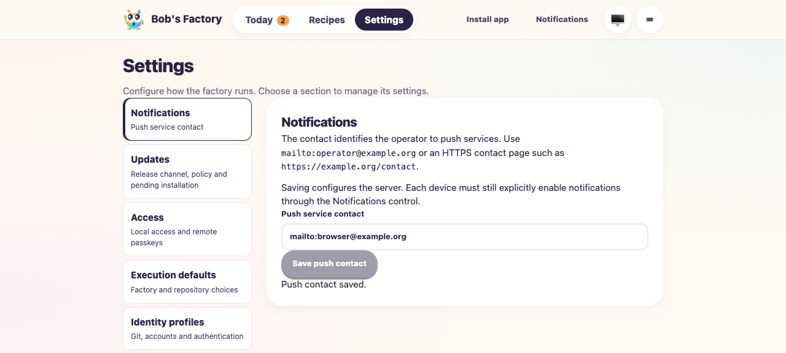

# Workflow compatibility with Taskbot, screenshot relocation and push settings

Date: 2026-10-14. PR: [#83](https://github.com/jappyjan/bobs-factory/pull/83).
Tested source: reviewed head `88a258bf` plus merge of frozen main
`a544fd2b1a93693ac15e438aea9c772f72f28811` and the three conflict resolutions.
The validation receipt in the retained evidence directory binds the final commit.

F1 applies to ticket setup/cancellation, retained screenshot review and running-worker
notification configuration. All agent/title execution and push delivery were simulated.
The drives use isolated repositories, Factory homes and capacity stores. No production
tracker, browser subscription, paid agent or real push service was used.

## Executed behavior

- A real EdgeWorker manual Taskbot setup stayed queued for 62,290 ms with no
  transport calls. Admission fetched complete ticket context, created a real
  worktree and completed the controlled role. The run exposed capacity waiting.
- Stopping a second queued setup prevented workspace creation and role execution.
  The separate stop-notification outbox remained distinct from canceled setup.
  Shutdown cleared all execution leases. Unit checks also verify native Codex
  transport selection and timeout cleanup after admission.
- The protected push API configured an already-running worker. Registration and
  saving the existing question sent no replay. Two fresh answer/question waves
  sent exactly once each through a recording sender; the second used the updated
  contact. Contact updates preserved every other stored field. Restart preserved
  the key and contact and sent no old alert.
- The maintained review-brief drive verified copied screenshot serving and guide
  refresh after removing the original home. Capture acceptance stayed unchanged;
  altered image bytes returned HTTP 409. Refresh retained a pending human gate.
- Headless browser session `manual19-fix21` checked invalid-contact feedback,
  keyboard submission, saved-value reload and unsaved-draft clearing on navigation.
  Saving invoked neither notification permission nor browser subscription.
  Desktop and 390px mobile screenshots were inspected; mobile had no horizontal overflow.



[Mobile screenshot](assets/workflow-main-r21/notifications-mobile.png)

## Commands and evidence

```sh
pnpm --filter 'bobs-factory-edge-worker...' build
F1_AGENT_MODE=mock pnpm --filter bobs-factory-edge-worker exec vitest run \
  test/EdgeWorker.factory-mcp-oauth.test.ts test/ScreenshotEvidence.test.ts \
  test/FactoryPush.test.ts test/FactoryServer.test.ts test/FactoryNotifications.test.ts \
  test/FactoryWebClient.test.ts test/WorkflowCatalog.test.ts test/WorkflowRuntime.test.ts \
  test/WorkflowNativeRecovery.test.ts test/WorkflowPendingWorkAdmission.test.ts \
  test/FactoryPipeline.test.ts test/Guide.test.ts \
  test/prompt-assembly.routing-context.test.ts --maxWorkers=1
F1_AGENT_MODE=mock F1_SCREENSHOT_RELOCATION=1 bun apps/f1/test-drives/assets/review-brief.ts
pnpm --filter bobs-factory-edge-worker typecheck
pnpm lint
```

All 290 focused tests passed. Build and type checks passed. Lint passed with 19
existing warnings. Required full build and type checks run again through the commit hook.
Both F1 drives passed. The Taskbot/push driver, receipts, logs, source fingerprints
and browser evidence are retained in:
`/Users/jappy/.bobs-factory/factory/evidence/manual-3db22f15-582b-4d93-82fb-9ab119d3f716/fix-r21`.
Run its `ticket-push-f1.ts` from the repository root with `F1_AGENT_MODE=mock` and
`F1_EVIDENCE_DIR` pointing to a fresh output directory. The retained `clean-run.py` wrapper clears inherited
Factory settings before execution; use `python3 <evidence>/clean-run.py bun
<evidence>/ticket-push-f1.ts`. It disables certificate verification only in
its isolated process for its generated loopback HTTPS fixture.

The initial review-brief invocation inherited a binary-launcher setting incompatible
with the older fixture's context argument index; a clean environment resolved it.
The initial Taskbot drive passed the timeout reproduction but expected an absent
setup flag instead of the saved `false` value. The corrected assertion and API answer
payload passed on the fresh final drive. Initial failure evidence remains retained.

## Compatibility and limits

WorkflowCatalog, bundled definitions/history, WorkflowRuntime, ChatSessionHandler
and RunnerConcurrency remain byte-identical to the reviewed head. Prior workflow
recovery decisions and evidence therefore remain applicable. Customized legacy
Simple stays recoverably blocked; older chats without a saved model use current
defaults, and uncertain conversation recovery without an ID stays blocked.

Live Taskbot/OAuth, real agents, physical-device notification receipt and production
HTTPS remain unverified. The simulated screenshot is proof of recovery mechanics,
not a product visual acceptance artifact. Reviewer reassessment, downstream CI/QA,
whole-PR brief regeneration and explicit human approval remain required. The actual
PR remains draft; this drive's fixture gates do not approve it. No merge or deployment.
