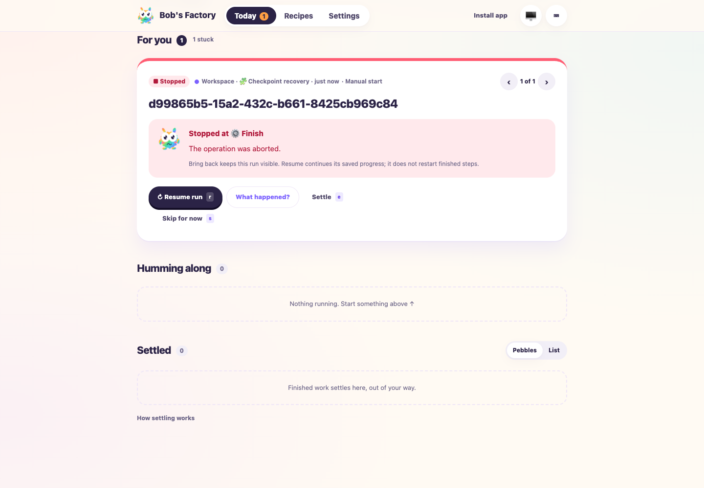

# Workflow compatibility with stopped-run recovery and update snapshots

Date: 2026-10-14. PR: [#83](https://github.com/jappyjan/bobs-factory/pull/83).
Tested source: `53ad1f22` plus frozen main
`0621f759e506badbaf46a090de2884651a76608e` and the conflict resolutions.
The retained `fix-r22/validation-receipt.json` binds the final commit and tested sources.

F1 applies to saved-run continuation, role context and notification settings.
All agent callbacks, tracker responses and push delivery were simulated. These
checks use isolated homes and repositories; they do not authorize production delivery.

## Executed behavior

- A stopped run survives restart without execution. Bring back makes its card
  visible under For you and executes no work. The built dashboard's `r` keyboard
  action resumes the saved native checkpoint. Calls are exactly `prepare, finish,
  finish`; the completed preparation and original history are preserved.
- The stopped-run regression also disables its workflow. Resume rejects while
  unavailable and leaves the checkpoint/history unchanged. Re-enabling does not
  execute anything; an individual Resume is still required. Existing blocked-run,
  native Simple and chat recovery tests pass on the combined implementation.
- The accepted-workflow drive uses a real EdgeWorker and stdio context MCP.
  A retained legacy graph survives recipe changes and resumes only its original
  implementation conversation. A fresh graph retains its actual approval gate
  and executes implementation only after exact fixture acceptance.
- The update lifecycle drive copies the same persisted wait, outputs, history and
  checkpoint used by production update preparation. Isolated preflight omits an
  expired evidence tooling link; snapshots and rollback preserve its exact target
  without reading it. The original run completes once after its answer.
- The notification fixture passes 26 headless browser checks for Settings routing,
  contact saving, device consent, navigation, access loss and reconciliation.
  Remote signed-out config and push reads return 401. Desktop and 390px phone
  captures were inspected; the phone checks show no horizontal overflow.



[Stopped-run phone view](assets/workflow-main-r22/stopped-mobile.png) ·
[Notification settings desktop](assets/workflow-main-r22/notifications-desktop.png) ·
[Notification phone controls, simulated unsupported browser](assets/workflow-main-r22/notifications-mobile.png)

## Checks and reproduction

394 tests passed: 307 worker, 20 CLI, 14 operator, 35 release-tool and 18 desktop.
The full build and lint passed; lint retains 19 existing warnings. The commit hook
runs the required full build and type checks against the final staged source.

```sh
F1_AGENT_MODE=mock pnpm --filter bobs-factory-edge-worker test:run \
  test/WorkflowCatalog.test.ts test/WorkflowRuntime.test.ts \
  test/WorkflowExecution.test.ts test/EdgeWorker.capture-recovery.test.ts \
  test/FactoryServer.test.ts test/FactoryPwa.test.ts test/FactoryWebClient.test.ts \
  test/SpecialistReview.test.ts test/prompt-assembly.routing-context.test.ts \
  test/WorkflowNativeRecovery.test.ts test/WorkflowPendingWorkAdmission.test.ts \
  test/ChatSessionHandler.model-recovery.test.ts --maxWorkers=1
F1_AGENT_MODE=mock node apps/f1/test-drives/assets/frozen-workflow-approval-context.mjs
F1_AGENT_MODE=mock bun apps/f1/test-drives/assets/desktop-service-lifecycle.mjs
F1_AGENT_MODE=mock bun apps/f1/test-drives/assets/bring-back-stopped-runs.mjs
```

Use the retained `fix-r22/clean-run.py` wrapper for F1 commands in a managed turn;
it removes inherited Factory settings and credentials from the isolated process.
Run `notifications-settings.ts` with `F1_EVIDENCE_DIR` pointing to fresh evidence,
then run `notifications-settings-browser.mjs` with a fresh named headless session.
The stopped-run fixture also supports `--api-only` without browser interaction.
Logs, receipts, browser driver and source fingerprints are retained at:
`/Users/jappy/.bobs-factory/factory/evidence/manual-3db22f15-582b-4d93-82fb-9ab119d3f716/fix-r22`.

The first worker run caught duplicate Resume route registration introduced by
merging two handlers. The final source retains one handler for workflow and native
recovery; all affected tests passed afterward. An added assertion was corrected to
match the existing availability error. Initial logs remain retained.

## Limits

The workflow-context fixture's in-memory tracker loses sessions on reconstruction,
so restored activity posting logs handled missing-session errors. Initial activities,
persisted workflow/native recovery and the fresh gated run pass independently.
This drive does not establish real-agent reasoning, production tracker recovery,
physical notification receipt, native app execution or an actual runtime upgrade.

Bundled catalog definitions, historical fingerprints and chat recovery source remain
unchanged from the previously reviewed head. Customized legacy Simple remains
recoverably blocked. Older chats without saved models use current defaults;
uncertain recovery without a conversation ID stays blocked.

Reviewer reassessment, downstream CI/QA, whole-PR guide regeneration and explicit
human approval remain due. Ticket synchronization remains unconfirmed. The PR stays
draft and unmerged; no deployment occurred.
