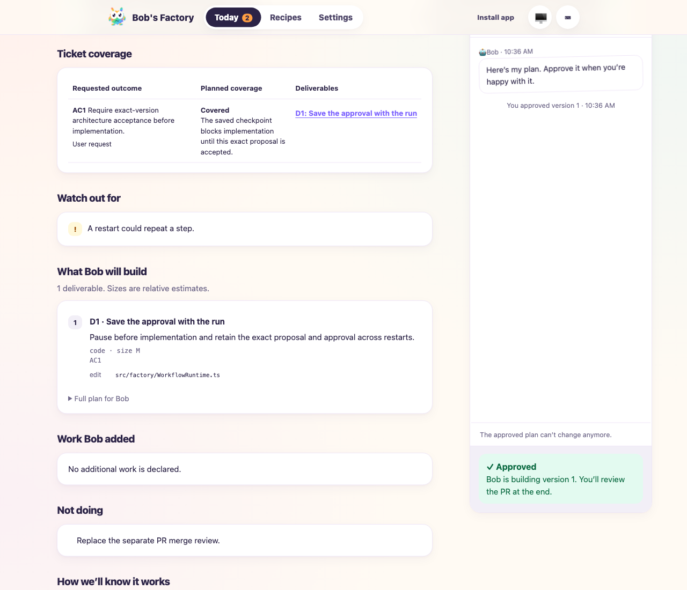
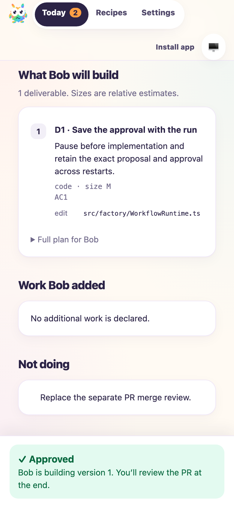

# Architecture review brief and planned footprint

**Date:** 2026-10-15  
**Scope:** Architecture generation, candidate review, approval and the reviewer page.  
**Implementation:** PR [#134](https://github.com/jappyjan/bobs-factory/pull/134), initially `2aa1625c`; final browser shell `0407fbd755ca792d6c707cc9`.

The local workflow produced a reviewable WAGO preparation proposal: three current-state findings, eight concrete deliverables, all five original ticket criteria plus one description requirement, 28 unique planned paths, explicit exclusions and six acceptance checks. The native candidate reviewer approved its exact version-3 digest. Hardware qualification and independent penetration/safety review remain visibly partial.

## Applicability and expected behavior

F1 applies because this changes generated planning contracts, runtime proposal validation/approval and activity rendering. The scenarios check that:

- New stock architecture roles require complete review content and valid criterion traces before approval.
- The runtime counts unique planned paths, classifies their scope, surfaces suspicious declarations and binds the resulting footprint into acceptance.
- The visible brief explains the current gap, deliverables, file operations, ticket coverage, added work, exclusions and acceptance checks without expanding the full implementation plan.
- Historical versions cannot accept the current design; the implementation handoff retains the reviewed content.

## Mocked F1 workflow

Run from the repository root:

```sh
F1_AGENT_MODE=mock BOBS_FACTORY_ARCHITECTURE_PORT=3998 \
  BOBS_FACTORY_ARCHITECTURE_EVIDENCE=/tmp/architecture-brief-mock \
  bun apps/f1/test-drives/media/2026-10-15-architecture-review-brief/dev-drive.ts
```

The isolated EdgeWorker uses an explicitly injected in-memory tracker, native workflow/runtime code and mocked provider responses. [Assertions](media/2026-10-15-architecture-review-brief/mock-validation.json) passed: the fixture issue can be created; approval hands off the exact structured candidate and the appended review requirements once; an incomplete brief is rejected before any proposal can be approved or further implementation starts. Three bounded correction attempts reject the malformed output.

These are mocked orchestration checks. They do not establish native model quality.

## Native WAGO generation and review

The same driver ran with `F1_AGENT_MODE=live`, a private context file containing the retained request/clarification/draft, and an isolated clone of the WAGO repository at `1959c870d0bbbdd42cc441b755d8230154ef0266`. Both architecture generation and candidate review used the real Claude runner. Background title generation was mocked; implementation was never started.

```sh
F1_AGENT_MODE=live \
  BOBS_FACTORY_ARCHITECTURE_SOURCE_REPO=/path/to/source-repository \
  BOBS_FACTORY_ARCHITECTURE_CONTEXT=/path/to/retained-context.json \
  BOBS_FACTORY_ARCHITECTURE_EVIDENCE=/tmp/architecture-brief-live \
  bun apps/f1/test-drives/media/2026-10-15-architecture-review-brief/dev-drive.ts
```

The first native review rejected missing parser files, an inaccurate current-state finding, invalid test commands and an overstated coverage claim. The workflow generated a revision. One change request through the actual review page then required the size-limit selection rule to appear in the brief and removed permission for undeclared conditional edits to another package. Version 3 passed native candidate review and waited for human approval. This was an iterative validation, not a one-shot quality claim.

The [native validation receipt](media/2026-10-15-architecture-review-brief/native-validation.json) records:

- All five original acceptance-criterion texts were compared with the retained issue and preserved exactly after whitespace normalization.
- The first four remain partial; publishing support/compatibility commitments is planned as covered. A sixth row covers description-level broker/credential hardening.
- Eight deliverables list 28 unique paths: 13 new, 15 edits; runtime inference yields eight code, nine test, seven documentation and four configuration paths.
- The final source recomputed the complete footprint and matched the stored metadata. No invalid paths, operation mismatches or unchanged-map contradictions remained. Intentional runtime/configuration scope flags stay visible.
- Existing byte caps and the rule for choosing new caps are visible in D2. Changes to the other plugin require a new accepted proposal and are excluded from the current file list.
- Proposal integrity, current gate identity and candidate-review digest match. No architecture acceptance or implementation occurred in the live case.

The full generated proposal, native transcript and live-page screenshots are retained locally. The published receipt omits the other repository's detailed findings and implementation plan. Prompt character-limit guidance was tightened after the trial exposed correctable formatting errors; the native correction path rejected those outputs before proposal creation.

## Browser checks

The rebuilt client was served against a copy of the persisted native run, preserving its actual versions, content, digests and approval state. This verified the current client without starting more native work. Desktop (1280 px) and phone (390 px) checks passed:

- All six coverage rows and eight deliverables render with the full plan closed; file lists are visible.
- Page width equals viewport width. The coverage table scrolls inside its card on phones, and long paths wrap.
- Coverage controls scroll to and focus the correct deliverable while preserving the hash route.
- Viewing version 1 disables approval of version 3; returning to version 3 restores the current proposal.
- The real local page accepted the change request and generated/reviewed the next version.

The public screenshots below show the separate mocked approval fixture, rather than the WAGO repository's detailed findings.





## Targeted checks and limitations

- 330 tests passed across 12 relevant architecture, runtime, catalog/migration, execution, server, routing and pipeline files. The page tests also passed after the in-page navigation fix.
- Full monorepo build and typecheck passed through the normal commit hook. Biome CI passed with existing warnings.
- Footprints describe declared planned paths, not an implemented diff. File kinds and owning areas are inferred from paths and existing package/project manifests.
- Native generation quality can require review and revision. Missing criteria or hidden work still require substantive review; schema validation only enforces structure and references.
- The WAGO plan prepares software assurance. It does not claim completed physical qualification or independent security/safety reviews.

The original WAGO run was left unchanged. Local validation servers and native runners were stopped after inspection.
