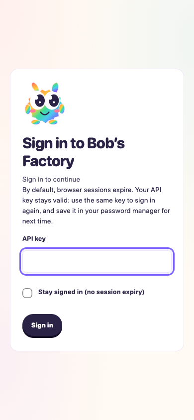

# Phone sign-in and optional no-expiry sessions

Date: 2026-10-16. Tested working tree based on `44a927fc4f5a226c0f163f68628e6bc5dde707f2`.
Dashboard build: `a0332733ceb3f386704c4f4c`. Runtime source hashes are retained in
[the final F1 receipt](assets/phone-session-no-expiry/f1-receipt.json).

F1 applies because this changes remote authentication, session persistence,
revocation, cookie renewal, and the dashboard access boundary.

## Scenario and setup

The expected behavior is explicit opt-in to no Factory session deadline, while
ordinary sessions retain their configured deadline. Reusing the same API key after
cookie expiry must work. Browser autofill without a typing event must submit the
field value. Logout and key rotation/removal must continue to revoke access.

Used a disposable copy of `assets/localhost-noauth.ts`, preserving the historical
fixture unchanged. The copy resolves imports from this checkout, expects schema 3,
and adds a fixture-only authenticated clock-control endpoint. A final socket/API
run additionally restarts against a version-2 store and verifies retained access
and its private backup, then signs in with `staySignedIn: true` before the existing
restart/revocation assertions.

```sh
F1_AGENT_MODE=mock F1_LOCAL_ACCESS_HOLD=1 bun run /tmp/phone-session-f1.ts
node /tmp/phone-key-autofill-qa.mjs
F1_AGENT_MODE=mock bun run /tmp/phone-session-f1.ts
```

Browser fixture: `/var/folders/5m/3pxzz_nd1v7f34rd9vnm01380000gn/T/f1-localhost-noauth-xaDvpc`.
Final socket fixture: `/var/folders/5m/3pxzz_nd1v7f34rd9vnm01380000gn/T/f1-localhost-noauth-ryfH7J`.
Ports: 3631 local dashboard, 3632 self-signed TLS remote proxy, 3633 worker,
3634 external-origin fixture. Deterministic mocked agents and scripted workflows;
no live model inference. All fixture listeners and workers stopped after checks.

## Results

- Chromium and WebKit at 390 × 844: password-manager metadata present; empty
  required input blocks submission; setting the DOM value without React input/change
  events signs in successfully. Reload retains the cookie session.
- Expiring the browser cookie returns to sign-in. The same key signs in again,
  now selecting **Stay signed in (no session expiry)**; the response has `expires: null`.
- Advancing only the fixture server clock by 100 years and pruning stored sessions
  retains authenticated access after reload and opens the real SSE ready stream.
  Logout revokes it. Neither browser stores the raw key in web storage.
- Final browser run: no uncaught errors. [Detailed browser results](assets/phone-session-no-expiry/results.json).
- Real HTTP/TLS F1 paths: local access, remote lock, sign-in, key management,
  rotation/removal revocation, restart, version-2 upgrade with backup, and legacy
  version-1 revocation all pass. Scripted authenticated work completes in an actual
  EdgeWorker worktree. The held browser drive also verifies external-origin denials.
- 114 tests pass across FactoryAuth, FactoryAccess, FactoryWebClient, FactoryServer,
  FactoryOnboarding and FactoryPwa. New regression cases cover indefinite retention,
  restart and revocation, version-2 migration/backup and invalid legacy null expiry,
  persistent cookie refresh, and the client without a deadline.
- `pnpm build`, `pnpm typecheck`, Biome on changed TypeScript and `git diff --check`
  pass. CSS has existing specificity/important warnings; no errors.

## Limits and harness adjustments

The T3 preview rejected the disposable certificate twice with
`ERR_CERT_AUTHORITY_INVALID`; the drive used local Playwright with fixture-only
certificate acceptance. The first browser runner referenced a missing WebKit
revision; switching to the already installed matching runner resolved setup.
One early WebKit reload interrupted an API-version request; waiting for the prior
navigation to settle produced the clean final run. This validates WebKit mobile
layout and simulated autofill, not a physical iPhone's password-manager save UI.
Server time travel does not remove browser cookie lifetime limits or eviction.

## Phone layout



## Active nightly fixture follow-up

Before release, updated the maintained `localhost-noauth.ts` fixture used directly
by `release-channel.yml`: expect auth-store version 3, sign in with
`staySignedIn: true`, assert `expires: null`, then retain the existing real-server
restart and revocation checks. Earlier test-drive observations above are unchanged.

`F1_AGENT_MODE=mock bun run apps/f1/test-drives/assets/localhost-noauth.ts` passed
against the PR working tree based on `b7f3ff1c`. The fixture exercised scripted
EdgeWorker worktrees and actual HTTP/TLS authentication, restart, key rotation/removal
and legacy migration. All listeners stopped normally.
[Exact source hashes and results](assets/phone-session-no-expiry/release-fixture-receipt.json).
