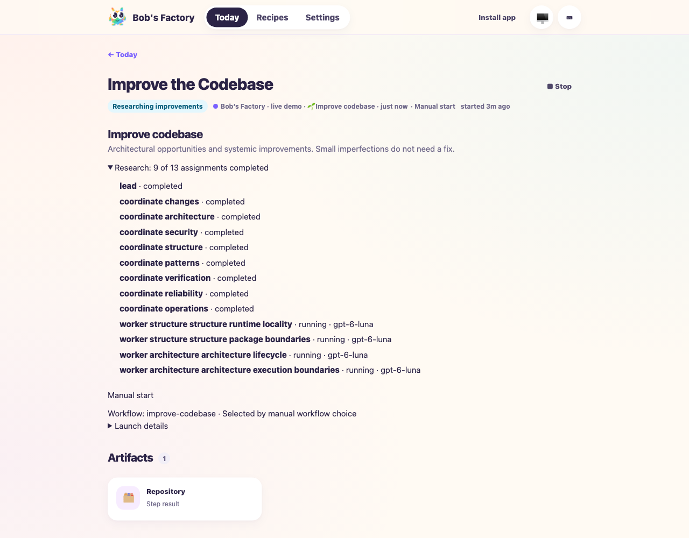
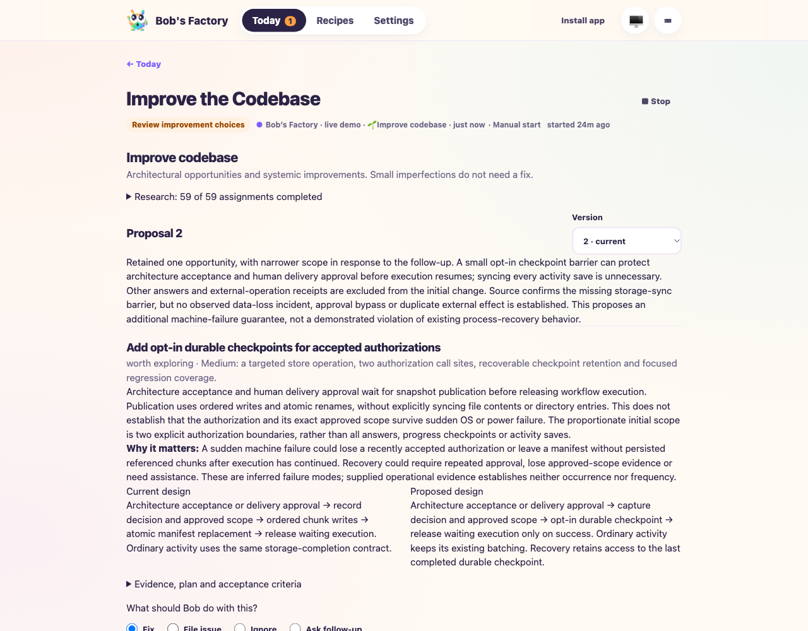
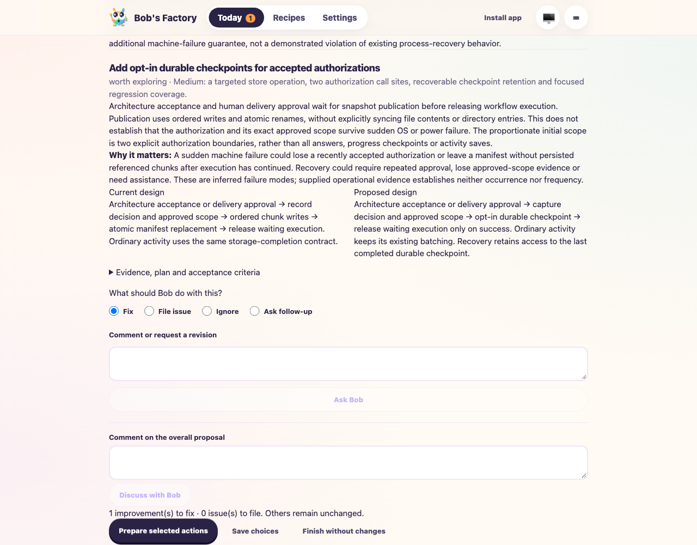
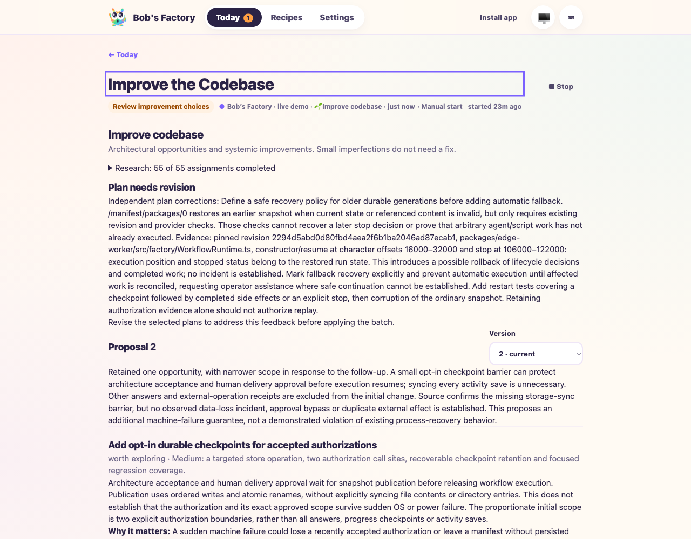
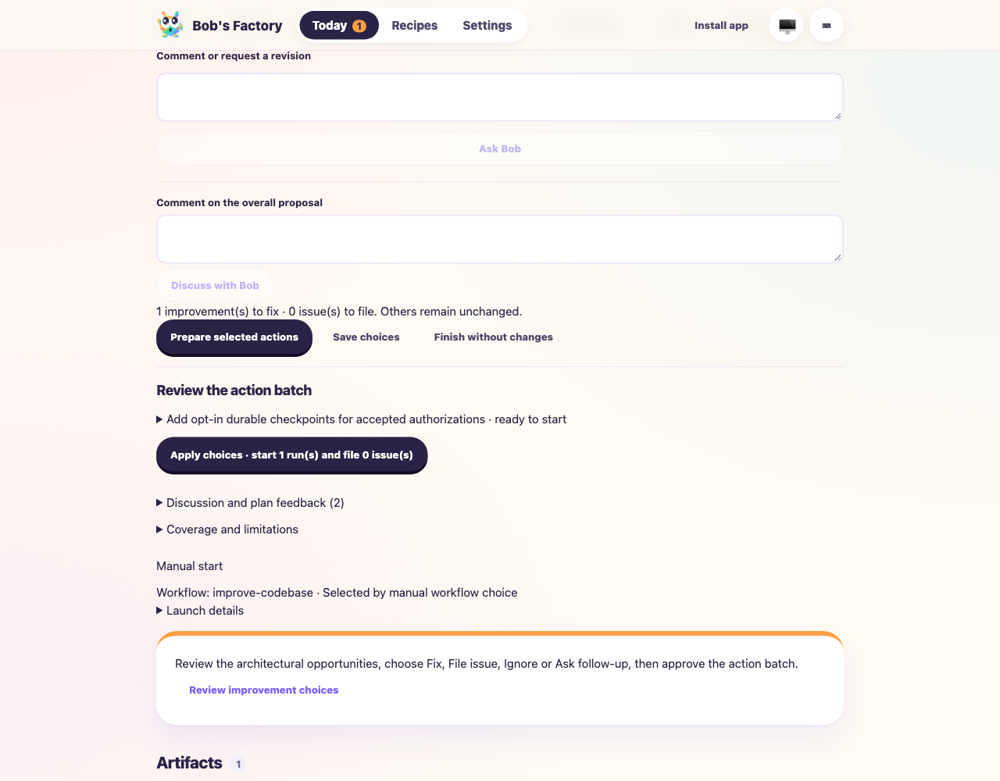
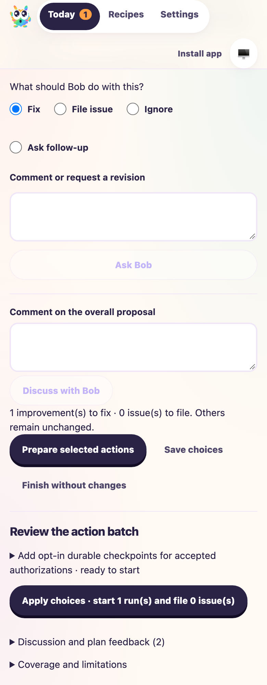

# Improve codebase: real Codex research and iterative plan review

**Date:** 2026-10-20  
**Scenario:** launch the stock workflow against Bob with empty inputs, inspect parallel research, revise a proposal through the dashboard, and prepare a checked action batch without applying it. The user explicitly requested real Codex agents.  
**Source:** isolated clone at `2294d5abd0d80fbd4aea2f6b1ba2046ad87ecab1`; host runtime subsequently includes the live-drive fixes in this PR. Frozen research instructions retain their original version.  
**Result:** discovery, follow-up, independent rejection/revision, restart recovery and final action preview passed. This is not a live implementation/delivery or tracker-creation test.

## Setup

```sh
F1_AGENT_MODE=live bun apps/f1/test-drives/media/2026-10-20-improve-codebase/live-drive.ts
# Restore the same persisted demo after rebuilding the runtime:
F1_AGENT_MODE=live BOBS_FACTORY_IMPROVE_RESTORE=1 bun apps/f1/test-drives/media/2026-10-20-improve-codebase/live-drive.ts
```

The embedded EdgeWorker exposes the real Factory dashboard on localhost:3600. It uses Codex CLI 0.163.0 with native ChatGPT authentication, `gpt-6.1-sol` for coordinators/planning/checks and configured cheaper `gpt-6-luna` workers. No runner mocks intercept this drive. The CLI tracker is offline; no Linear/Taskbot credentials or delivery destination are configured. A separate Factory home and local-origin clone prevent research from writing to the source checkout or production tracker. The normal worktree setup hook installs dependencies.

Thirty repository-matched Bob histories from the past 30 days were read from local state. Only dated metadata, wait reasons, recent attempt provenance and categorized errors were offered to research; raw prompts and credentials were excluded. Temporary observations were removed from the demo's run map after the operational snapshot was captured. Native credential stores were preserved.

Run: `manual-0df4538b-9dfb-4bca-b314-22a38c5d1c04`. The demo home is recorded locally in `/tmp/bobs-factory-live-improvement.json`; it is intentionally left open, waiting for the user's UI inspection with no active inference. Stop only its process with SIGINT to close it cleanly. The drive does not call Apply choices automatically.

## Observed behavior

1. Empty inputs launched one lead, eight perspective coordinators, sixteen cheaper workers, eight coordinator verification jobs and synthesis: 34 real Codex assignments. Research was parallel and used scoped pinned-repository/context tools. Twelve initial workers returned no candidate. Coordinators rejected weak file-size/import-only restructuring suggestions and an intentional compatibility boundary. Zero findings remained valid.
2. Reviewers considered real history without treating legitimate human waits or recovered capture failures as stuck runs. Runtime/revision mismatches and incomplete incident evidence were acknowledged. No confirmed recurring stuck-run defect survived synthesis.
3. Proposal 1 retained one optional checkpoint-durability opportunity. The UI follow-up asked which decisions needed a stronger guarantee and whether an opt-in barrier could avoid syncing every activity save. Four targeted perspectives produced another 17 jobs. Proposal 2 narrowed scope to architecture acceptance and human delivery approval, retained version 1, and cleared choices rather than silently selecting Fix. It explicitly distinguished a hypothetical machine-failure risk from an observed incident.
4. Ignore was saved and retained without side effects. File issue exposed the missing-destination state and blocked preparation until a destination exists. Fix was selected solely to prepare a plan. No Apply click occurred.
5. The first package and three parallel checks added four jobs. Security rejected automatic fallback to older durable snapshots because it could replay completed effects or reverse a later Stop. The batch returned to discussion, exposed feedback, and offered no Apply action.
6. After the retry-cache fix, Revise selected plans created four fresh jobs. The revised plan requires an explicit recovery hold, reconciliation and operator assistance when uncertain. Architecture, security and dependency checks all approved. Final state: **59 completed Codex jobs, 59 distinct native sessions, phase ready, no acceptance, zero issues and zero Factory children**. [Sanitized receipt](media/2026-10-20-improve-codebase/live-evidence.json) records job roles/statuses and checks without raw transcripts or history.
7. Two runtime restarts retained successful native sessions, proposals and choices rather than repeating research. The first restart compared the retained proposal digest and all 34 native job identities/statuses. The final persisted-state assertions above passed after the second restart.

## UI inspection and corrections

The live drive exposed and corrected static template-based progress counts, permanently cached invalid synthesis references, and stale plan checks after feedback. Validation now runs before caching synthesis completion; planning identity includes retained comments. New preparation/comments invalidate old manifests. Independent rejection is visible above the proposal with a Revise selected plans action. File issue explains missing connections and offers destination refresh.

The browser showed all four actions, real research transcript rows, current/historical proposal versions and exact action counts. Historical version 1 disabled all choices and hid Apply; returning to version 2 restored its prepared batch. The desktop and 390px mobile layouts had no horizontal overflow. Existing mocked validation covers applying mixed choices and launching independent children; this live drive deliberately stops at the review boundary.








## Verification and limits

Focused `Improvement.test.ts` and `FactoryWebClient.test.ts`: **62 passed**, including regression protection for invalid proposal retry, fresh checks after rejection, manifest invalidation and actual research activity projection. The EdgeWorker/web build and changed-file Biome passed. Repository commit hooks run the full monorepo build/typecheck.

The first harness attempt failed before discovery because temporary imported observations lacked normal run projection fields. The harness was corrected and a fresh demo was used; this was not counted as successful live research. In the passing run, synthesis initially put prose into opportunity-ID fields; the native correction loop repaired it. The lead reached its repository-tool budget and recorded limited coverage; other researchers independently inspected source. These facts limit confidence in completeness. No clean bill of health, production failure rate, billing total, real issue creation, live implementation child, Git-provider delivery or power-loss guarantee is established. The one optional proposal should still be judged for value by the user.

See the [separate mocked orchestration/delivery drive](2026-10-20-improve-codebase.md) for controlled Apply and child-gate coverage. Arbitrary live databases/log connectors remain outside the current implementation.
