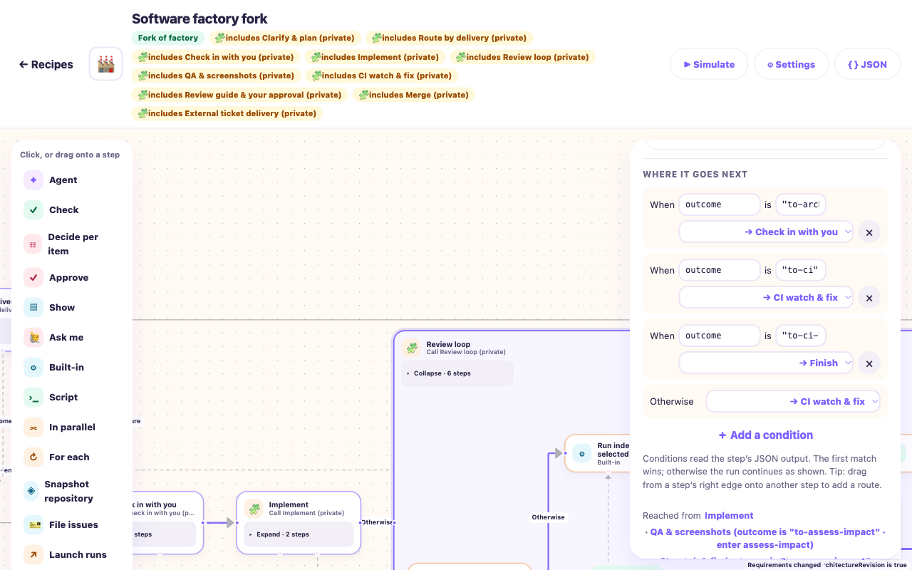
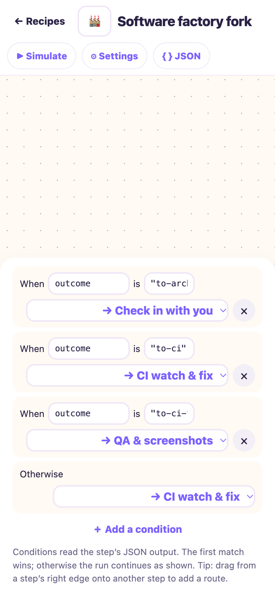

# Taskbot #142 / PR179 — combined Round2 repairs

Implementation response to authoritative report2427. **No independent acceptance or merge clearance is claimed.** Stable findings are R2/R3/R5/R6/R7; the report's source-helper aliases do not add findings. R1/R4 remain preserved.

PR: https://github.com/jappyjan/bobs-factory/pull/179  
Retained checkout: `/Users/jappy/.t3/worktrees/bobs-factory/taskbot-142-composition`  
Branch: `taskbot/142-composition`  
Base: `578bb28233fe699b6743bf84cb24895b25da3ed0`, tree `1865063520489946c3d6540b94910f46c8ad32a8`. Fresh main still matches.  
Pre-repair candidate `149b3e2f` / tree `1c8df2e3` and original `d682d670` remain historical **NOT CLEAN**.

Read the full current142/135 and report2427, including all criteria, execution/reuse limits and alias mapping. Applied canonical implementation, verify-and-ship and F1 policies; current skip-CI/consolidation and functional-only instructions override older broad gates. Configuration read back unchanged: codex/gpt-6.1-sol, priority/Fast, xhigh; Node24.21.0/pnpm10.33.1. No new helpers. All execution used the retained checkout or own disposable homes. Its manual worktree does not rebind T3's inherited coordinator workspace.

## Combined corrections

| Stable ID | Root cause and correction | Practical proof |
| --- | --- | --- |
| R2 | Imported freshness hydrated only the immediate Call. Comparison and actual execution now share lexical input hydration using the actual configured producer keys, including enclosing ports through container frames. | Same Git revision, actual root seed1→2, completed Parallel producer refreshes to2. Original controlled session resumes, original visits become2, adjacent action remains1, original history prefix and both producer results remain. Direct Git A→B and accepted-answer restart evidence is retained from this round's earlier focused selection. |
| R3 | A standalone rejection returned the root outcome instead of continuing planning. A declared Check reads runtime-owned caller context: standalone correction goes to its local planner; called correction returns `to-plan` through ordinary caller routes. | Two current production-runtime/host drives: standalone30 history / called32 history, each10 mocked agent roles and2 exact human decisions (reject, then new approve). Each initial and corrected plan has an independent rejected review before acceptance. Original history remains; stale old review approval rejects. The called flow re-enters the same child at `plan`. Final proof belongs to the new exact review. |
| R5 | Destination editing retained an entry belonging to the old callee. The primary handler now keeps an entry only when the new target is an outcome-enabled Call whose callee declares that actual step. | Real catalog save/reload controls preserve compatible CI entries and clear entries for Finish, another Call and Return. Actual app: two new Factory forks change original `{next:ci,entry:ci-fix}` to Finish and QA, save, export and reload successfully. |
| R6 | A single-owner Map silently let duplicate preparation roles overwrite original planning owners. The bounded legacy adapter now handles every matching owner deliberately. | Real workflow-catalog-v1 load/save/reload retains clarify/plan/plan-review runner, model, reasoning and product tier `fast` at clarify-plan, route-delivery and external-delivery. Explicit current overrides win; conflicts remain visible with the owning callable role identified. No frozen/local graph rewrite. |
| R7 | The standalone router had no executed planning producers. It now declares clarification, decisions, planning, independent rejection/review and contract acceptance. Configured Call ports retain the composed path; copied JSON is never authority. | Current standalone router returns `to-external-apply` with an authorized reviewed contract and zero tracker mutations. A real composed router uses planning's qualified producers without repeating clarification. Missing/unreviewed preparation and a copied-approved-context fork refuse before effects. |

The generic `@caller` source describes the nearest actual enclosing Call and its declared bindings. It is read-only configuration context, not execution or approval evidence. Checks use the normal `/inputs` namespace. There is no Factory-name, role-ID or workflow-name interpreter.

A preparation-only outcome recipe can finish its block and return a route without claiming delivery completion. The existing final proof requirement remains for frozen graphs without outcomes, reachable graphs declaring delivery actions, and runs retaining delivery effects/verification. The controlled router test also declares an unexecuted external-delivery dependency and confirms that final proof is still required. Product human/provider/CI/handoff guards are retained; no acceptance JSON is promoted into authority.

R1's lexical producer ownership remains intact. Its two current ordinary Parallel/For each positives execute distinct qualified receipts even for equal JSON; prior invalid/sibling/inherited and forwarding controls remain qualified evidence. R4's current targeted tests retain mapped versions[1,2], original child visit limits, Snapshot origins and active Call ownership publication without accepted-child replay. The refresh/re-entry mechanism does not reset progress budgets or introduce #144/#145/#147 policy.

## Verification and freeze

Final source/harness freeze: **46 inputs**, [r2-inputs.json](media/taskbot142-composition/r2-inputs.json), SHA256 **54ad3c665cb5c98d23a5ca543cccdc0d69f3844834a8033b3a4a4ff2124eb521**. Rechecked unchanged after checks. No source/test/harness mutation during a check. Later additions are this report and evidence artifacts only.

- Final changed routing drive: **5 PASS /9 SKIP**, exit0,31.11s. Includes standalone/called correction, router preparation/composed ports/copied authority/unfinished delivery, missing and unreviewed preparation.
- Final ownership/catalog/full-prompt selection: **8 PASS /21 SKIP**, exit0,3.31s. Includes mapped input/Snapshot refresh, original pass limit, active Call publication, R5/R6 and complete role-prompt assertions.
- Earlier affected selection: **6 PASS /1 FAIL /17 SKIP**,25.70s. Its passing R1 positives and R2 enclosing-input proof use unchanged owning runtime/test bytes; the remaining failure was the composed router later fixed by the declarative Check namespace correction. This command is not labelled a clean final suite.
- Earlier combined selection: **29 PASS /1 FAIL /47 SKIP**,28.04s. It adds direct revision/input freshness, invalid/forwarded ports, waiting/restart, legacy preference and entire routing-prompt controls. Later targeted runs replace affected results. This is retained scoped evidence, not an exact-final whole-suite claim.
- Final owning Node type/emit: exit0, no diagnostics. Owning web typecheck exit0 before the last Check-pointer/fixture-only delta; unchanged UI owning inputs reused. Actual web build exit0: **b2755fc919b46c9bca8dba40**. No dependency changes, broad/native build or hook gate claim.
- All **663 existing complete compact prompt expectations remain byte-equal**;18 added owner keys reuse the original full role text,681 total. The changed capability reference and its entire expected routing prompt describe caller context, standalone preparation, correction, entry editing and preference preservation. No partial prompt assertion was substituted.
- Stock roles, static frozen definitions, Improve, Incremental, WorkflowExecution and EdgeWorker remain byte-equal to149b. All9 genuine141 definitions and41 original roles retain the previously authenticated baseline. No automatic accepted-run/fork upgrade.
- `git diff --check` passes. No development CI fields, query, trigger, watch, poll, retry or workflow finalization.

[Receipts](media/taskbot142-composition/r2-receipts.json) publish small hashes/counts for21 logs and6 current raw files. Exact commands and exits are recorded there; raw data stays locally under `/tmp/taskbot142-r2-*`. Earlier failing attempts remain failures: reproduced stale seed/root correction/router refusal; a missed import; a transient test wait predicate; schema normalization of a control fixture; an out-of-scope completion variable caught by owning types; and the Check namespace defect caught by the composed control. An initial read-only comparison used a nonexistent Improve filename and was corrected. Local failing seed JSON was overwritten by its passing probe; the original independent failure bytes under `/tmp/taskbot-142-review-r2-fast` remain historical. No old raw bytes were reconstructed.

## Actual editor evidence

Actual Node24 FactoryServer/WorkflowRuntime, ordinary local authentication, real app-created private closures. Hooks prohibit agent/provider execution. [Accepted configuration and editing receipts](media/taskbot142-composition/r2-ui.json).

Both edits reload their selected values and export without the incompatible child entry. Other route branches and input bindings remain intact. The existing editor save also materializes empty reads/rules/checks/instructions and workspace access defaults on Calls; the whole serialized object is therefore not described as a one-field-only change. At360px, document width360; Tab from the changed selector reaches Remove route. Fresh editor evidence is light only. Historical desktop/390 light/dark collapsed/expanded and360 canvas evidence remains qualified historical evidence; no full matrix replay or physical-device claim. The renderer's layout/collapse logic is unchanged by this repair.

## Complete criterion disposition

| Criterion | Current disposition / retained limits |
| --- | --- |
| Ten static forkable blocks; short Factory/Takeover; no postconstruction patching | Preserved. Router and external standalone paths now have current controlled execution. Other block standalone permissions/ports and static topology retain earlier source/drive evidence; no speculative ten-block matrix added. |
| Clarify/decisions/plan/independent rejection; all delivery routes | Current direct/called preparation and rejection tested. Repository/external/mixed/deferred routes remain declared; deferred retains source-only evidence. |
| Meaningful architecture exact approval/routine bypass; implement/push/draft | Retained repository meaningful/stale/exact and mixed routine/Takeover/local-Git evidence. No new native inference claim. |
| Impact/specialists/Parallel/Check/fix/unchanged-cycle limits | Current lexical/freshness/limit controls; historical actual repository rejection/correction retained. No145 reuse redesign. |
| QA/screens/video/visual fix; product Watch CI/fix/after-fix/passive waits | Original roles/routes and repository Node-QA/mock-CI proof retained. No live CI/media/native/device replay. |
| Guide/handoff/human correction; merge rework/provider-confirmed result | Historical136-receipt repository correction proof retained, including handoff→CI fix, merge rework→impact, fresh human decisions and mocked provider merge. Its whole runtime input is historical; current generic changes have targeted proof. |
| External apply/verify/guide/human/correction/final/reverify | Current standalone/called reject→reviewed correction→new exact approval→final proof. Historical mixed/external/reverify evidence qualified; uncertainty reconciliation code unchanged, not newly driven. |
| Outcomes/entries/ports/frames/sessions/receipts/Snapshots/restart | Current changed-boundary and ownership checks above; original receipts/visits remain. No copied/inherited evidence promotion or unrelated side-effect replay. |
| Frozen141/copied forks/preferences/native conversations | Genuine historical definitions/roles unchanged; preference repair current. Existing native/pending decisions/recovery destinations are not rewritten; no native matrix replay. |
| Canvas/fork closure/phone/keyboard/route authoring | Current two actual fork saves/export/reloads, desktop390 light and360 keyboard/overflow. Original canvas matrix retained within its historical scope. |
| Full prompts/capability/changelog | Full role expectations and capability fixture updated/preserved as described; user-facing CHANGELOG links179. Existing security/outcome/timeouts were not weakened. |
| Four named F1 flows | F1 APPLICABLE. Relevant current mock runtime/host changed paths above. Repository136 plus historical external23/mixed94/Takeover65/frozen141external14 remain retained evidence, not fresh four-flow proof on this candidate. Original overwritten repository bytes remain historical, replaced by the retained136 proof. |
| Epic decisions/scope/DoD | Generic configured agents/Check/Calls/humans/actions and universal forkability except Simple retained. No143–148 work, deployment, release or active production editing. One ready PR; independent acceptance remains parent-owned. |
| CI/broad consolidated checks | All development CI and broad monorepo/package/app/script/audit/native/full-suite checks deferred post148 by user policy, not passed. No dependencies changed. |

All own runtimes shut down; both preview tabs closed, both server PIDs stopped and owned UI homes removed after saving their configuration. Synthetic test homes clean up in afterEach/finally. No owned server/browser is retained. Native credential stores/history were not inspected or changed. Published commits use `[skip ci]`; parent retains new independent whole-diff acceptance, statuses and guarded merge.

